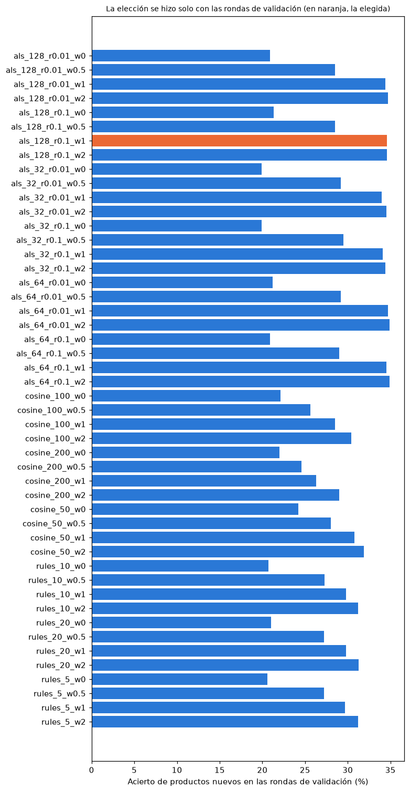
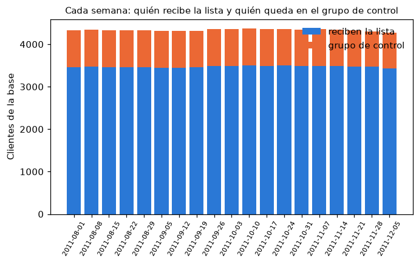
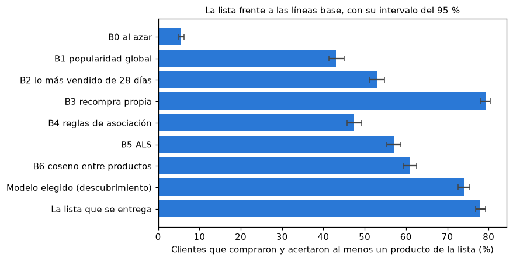
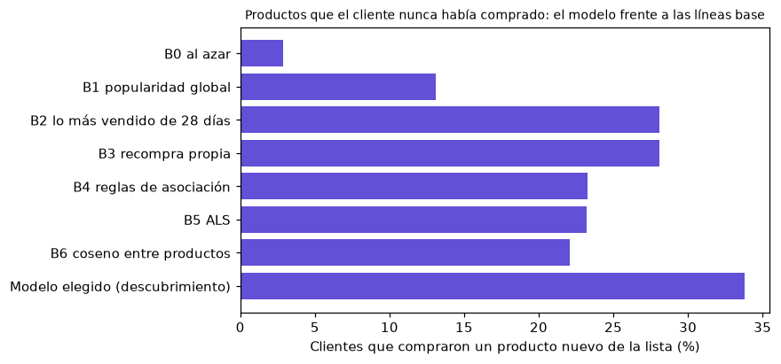
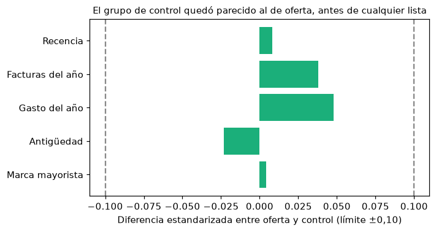
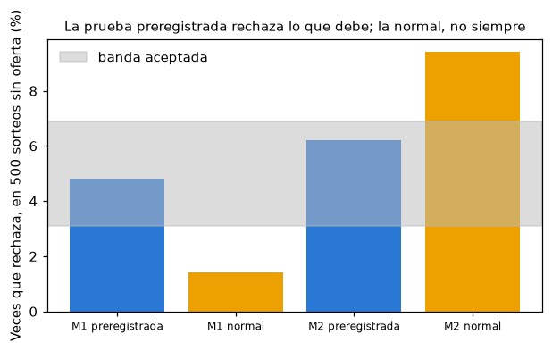

# Una oferta para cada cliente, armada sola

[English](README.md) · **Español**

| | |
| --- | --- |
| **Propuesta de valor** | Una lista de 10 productos por cliente cada lunes, cada producto con su origen (recompra, descubrimiento o reserva), entregada a un CRM con un grupo de control listo para medir una campaña |
| **Stack tecnológico** | Python 3.11, pandas, NumPy, SciPy, implicit (ALS y similitud coseno), PyArrow y Parquet, SQLite, openpyxl, FastAPI y uvicorn (el CRM sustituto), Matplotlib, pytest, Apache Airflow sobre Docker Compose, y el diseño de un tablero de Power BI en HTML |
| **Técnicas** | Recompra propia, reglas de asociación, ALS implícito, similitud coseno, mezcla con la tendencia de 28 días, grupo de control estratificado, CUPED con permutación estratificada, remuestreo por cliente pareado, validación temporal por rondas semanales con sello |
| **Para auditar** | [Ficha del modelo](docs/model-card.md) · [Evaluación independiente](docs/evaluation.md) · [Última corrida: resumen sellado](reports/evaluation_summary.md) · [Registro de decisiones](docs/decisions.md) |

Este README sigue la estructura común de los proyectos de datos del portafolio, descrita en `ESTRUCTURA-PROYECTOS.md` en la raíz del portafolio.

## 1. Resumen ejecutivo

### 1.1 Problema de negocio y solución

Un flujo que cada lunes arma una lista de 10 productos para cada cliente de una tienda en línea, aparta un 20 % de los clientes como grupo de control, entrega las listas del resto a un CRM por una API REST y, al cierre, mide qué tan bien cada lista anticipó lo que el cliente compró esa semana. Los datos son **reales y públicos**: Online Retail II de UCI, las facturas de una tienda en línea del Reino Unido que vende también a mayoristas, de 2009 a 2011. El archivo **no tiene ofertas**: nadie recibió una y ningún cliente quedó fuera de una campaña, así que **no se mide el efecto de una oferta**. Lo que se mide es qué anticipa cada lista y si el grupo de control quedó bien armado.

**El problema.**

Una tienda en línea manda la misma promoción a toda su base, aunque cada cliente compra cosas distintas, y armar una oferta para cada uno a mano es imposible. Marketing no sabe qué producto poner delante de cada cliente, el equipo de CRM no tiene una lista por cliente para cargar cada semana y dirección no sabe si una oferta personal agrega algo, porque nadie dejó un grupo sin oferta para comparar.

El archivo marca el límite desde el principio. Una de cada cinco filas (22,5 %) no tiene número de cliente: son compras de invitados, que sirven para saber qué se vende y qué se compra junto, pero que no son un cliente. No hay descuentos que sean ofertas al azar (las 173 líneas de descuento no lo son), ni categorías de producto, ni costos. Lo que el proyecto puede afirmar es acotado: qué lista le arma a cada cliente, cuánto de lo que el cliente compra esa semana ya estaba en la lista y si la prueba de un experimento futuro está bien calibrada.

**La solución.**

Un flujo de trece tareas que simula la operación sobre el archivo, partido en un lanzamiento (la historia hasta el 2011-07-31), 18 entregas semanales (del 2011-08-01 al 2011-11-28) y un cierre. Cada lunes, con lo comprado hasta el domingo anterior y nada posterior, arma la lista de cada cliente que compró en el último año, la entrega al CRM y deja a un lado el 20 % del control. Lo emitido no se rehace.

Cuatro piezas hacen el trabajo:

1. **Una lista de 10 productos por cliente**: hasta 7 que el cliente ya compró, ordenados por su propia recompra, y el resto productos nuevos que arma el modelo elegido (ALS implícito mezclado con lo más vendido de las últimas cuatro semanas); si el modelo no tiene candidatos, se completa con lo más vendido de 28 días. Cada producto lleva su origen.
2. **Una elección con rondas de validación**: 48 recetas candidatas se miden solo en las 13 rondas anteriores al 2011-08-01; la receta elegida (`als_128_r0.1_w1`) se congela en un sello antes de abrir la prueba.
3. **Un grupo de control listo**: el 20 % de la cohorte del lanzamiento, estratificado por recencia, frecuencia y marca de mayorista, sorteado una sola vez con una semilla sellada. Sin ofertas en el archivo, lo que se muestra es su equilibrio, el A/A (la prueba aplicada a dos grupos que no recibieron nada), su calibración y el menor efecto detectable.
4. **Una entrega al CRM**: un CRM sustituto local con la forma de una API REST, idempotente, con lectura de vuelta y un CSV para la herramienta de correo; ningún cliente del control llega a ninguno de los dos.

El resultado central no es un modelo, es una medición. Se cumplen ocho criterios y **no se cumple** C03 (ver 1.2).

**Para qué sirve.**

- **Marketing** ve, para cada cliente, qué productos pondría una campaña de la semana y de dónde sale cada uno: recompra, modelo o lo más vendido.
- **CRM y correo** reciben una lista por cliente por una API REST y un CSV, sin duplicados al repetir una carga, y un grupo de control que nunca recibe nada.
- **Dirección** ve cuánto de lo que los clientes compran esa semana anticipa cada lista, contra líneas base honestas, y el tamaño que necesitaría una primera campaña para que su efecto se pudiera ver: el menor efecto detectable.
- **Para un tablero:** las tablas en estrella y el diseño en HTML dicen cómo armar las páginas en Power BI Desktop.

Lo que no sirve: decir cuánto vende una oferta, porque el archivo no tiene ninguna; elegir el descuento, porque no está en los datos; servir a clientes que nunca compraron, porque no existen para el CRM hasta su primera compra.

### 1.2 Criterios de éxito e impacto

Los criterios C01-C10 se fijaron antes de escribir código, con lo esperable de cada uno, y la prueba se evaluó una sola vez bajo un sello. La lista debía superar a lo más vendido de 28 días (C01) y no perder más de 5 puntos frente a la recompra propia (C02); superar a la recompra propia (C03) se esperaba que probablemente no; el modelo debía descubrir mejor que lo más vendido en productos nuevos (C04) y cada cliente recibir su propia lista (C05); el grupo de control debía quedar equilibrado (C06), con una prueba calibrada (C07) que en el A/A no marcara una diferencia que no existe (C08); y lo entregado al CRM debía ser lo decidido (C09). C10 es informativo.

De los nueve criterios con umbral se cumplen ocho y **no se cumple** uno, C03: la lista no le gana a la recompra propia del cliente, la base más difícil de superar. En las 18 rondas de la prueba la lista acierta al 78,0 % de los clientes que compraron, lo más vendido de 28 días al 52,9 % y la recompra propia al 79,2 %; en productos nuevos, el modelo elegido acierta al 33,8 % y lo más vendido al 28,1 %. Cada criterio contra su resultado, en [5.1](#51-evaluación-frente-a-criterios-de-éxito).

## 2. Datasets y preparación

### 2.1 Fuentes, alcance y granularidad

| | |
| --- | --- |
| Fuente | Online Retail II (Chen, 2012), UCI, CC BY 4.0: `online_retail_ii.zip`, 45.622.418 bytes, SHA-256 `572e3627…7bfb` |
| Filas | 1.067.371 en dos hojas (525.461 y 541.910), del 2009-12-01 al 2011-12-09; 22.523 copias del solapamiento entre hojas quitadas, 1.044.848 líneas |
| Clientes | 5.852 con alguna compra; 4.234 con dos o más facturas (72,4 %); 39.516 facturas de clientes y 2.922 de invitados |
| Canastas | mediana de 15 productos por factura; 4.877 productos distintos |
| País | el Reino Unido concentra 935.026 de las 1.044.848 líneas |
| Mayoristas | 339 de los 4.326 clientes de la base del lanzamiento, con la regla del proyecto 02 |

La unidad de análisis es el par (ronda, cliente): la base de una ronda son los clientes con alguna compra en los 365 días anteriores a su lunes.

- **Datos reales y públicos**: no se inventó ninguna fila. Una de cada cinco (235.287, 22,5 %) no tiene cliente. Esas compras entran en las reglas de canasta y en la popularidad, nunca como un cliente.
- **Los mayoristas** entran en la base y en las ofertas; la marca es un estrato del control y un corte de informe, nunca una variable de un modelo.
- **El calendario**: historia desde el 2009-12-01 hasta el 2011-07-31, 13 rondas de validación (del 2011-05-02 al 2011-07-25), 18 rondas de prueba (del 2011-08-01 al 2011-11-28) y una ronda censurada del 2011-12-05, de cinco días, que es solo informativa.
- **Para las pruebas** hay un libro de 300 clientes ficticios (`make-fixture`) que nada de lo anterior usa: el modo rápido corre sobre él.

Las 8 columnas, los roles, las covariables y una tabla por Parquet están en [docs/data-dictionary.md](docs/data-dictionary.md).

### 2.2 Saneamiento y reglas de calidad

- **Los roles de línea**: 788.187 `purchase`, 226.757 `guest_purchase`, 19.165 `cancellation`, 5.938 `bad_price`, 4.795 `non_product` y 6 `adjustment`, en el orden de RF04.
- **Las 173 líneas de descuento** (código `D`) no son ofertas al azar: son descuentos de una factura y quedan fuera de la regla de producto. El archivo no dice qué cliente recibió qué promoción.
- **Recuentos de la fuente** (AC03 y AC04): 1.067.371 filas (525.461 y 541.910 por hoja), 22.523 copias del solapamiento quitadas, 1.044.848 líneas, 11.812 repeticiones internas marcadas, 235.287 líneas sin cliente y 5.993 fuera de la regla de producto.
- **Las reglas de cada entrega**: V10 a V18, con su severidad y las filas que tocaron, en `outputs/site/validation_rules.json` y en el diccionario.

## 3. Arquitectura y metodología

Trece tareas que corren siempre en este orden, las mismas desde la línea de comandos (`python -m personaloffers run`) y desde el DAG de Apache Airflow: `fetch_source`, `deliver`, `validate`, `load`, `track`, `build_base`, `fit_recipe`, `recommend`, `deliver_offers`, `evaluate`, `export`, `render_dashboard` y `report`.

### 3.1 Fuente e ingesta

La entrega es la fuente de las líneas: como no hay un sistema de origen, el flujo parte el archivo en un lanzamiento, 18 semanas y un cierre. Cada línea de compra cuenta en la ventana de una sola ronda.

La fuente es un archivo no confiable: el zip y el libro se leen con tamaño y huella fijados, con topes de descompresión, sin macros ni vínculos externos, y los arreglos de los modelos se guardan como `.npy` con su SHA-256 y se leen sin `pickle`.

### 3.2 Orquestación y transformación

La orquestación semanal es un DAG de Apache Airflow en Docker (`personaloffers_weekly`), como en los proyectos 01 a 07, por decisión del dueño (D26). Corre las mismas tareas que la línea de comandos cada lunes, con los secretos del entorno y un servicio para el CRM.

```mermaid
flowchart LR
  A[fetch_source<br/>el zip de UCI] --> B[deliver<br/>la siguiente entrega]
  B --> C[validate<br/>reglas V10 a V18]
  C --> D[load<br/>SQLite, todo o nada]
  D --> E[track<br/>qué compró cada uno]
  E --> F[build_base<br/>base, covariables, control]
  F --> G[fit_recipe<br/>reajuste con la receta sellada]
  G --> H[recommend<br/>las listas]
  H --> I[deliver_offers<br/>CRM y CSV]
  I --> J[evaluate<br/>la prueba, una vez]
  J --> K[export<br/>25 tablas y 6 JSON]
  K --> L[render_dashboard<br/>HTML]
  L --> M[report<br/>cierra la corrida]
```



### 3.3 Almacenamiento y modelado de datos

**Las tablas del modelo estrella** (`outputs/powerbi/`): 24 tablas en Parquet, con claves únicas, integridad referencial y ninguna celda de menos de 10 clientes; la lista de cada cliente está en una tabla privada que no se versiona. Cada tabla, con sus columnas, su tipo y su clave, está en el diccionario de datos.

### 3.4 Experimentación y Machine Learning

El lanzamiento elige la receta con las 13 rondas de validación, la sella y sorteó el control; cada semana reajusta con esa receta y la historia anterior a su lunes. El sello guarda la huella de cada clave de la configuración que cambia un valor sellado: una evaluación con otra configuración se rechaza antes de escribir.

#### 3.4.1 Ingeniería de características y línea base (baseline)

**La recompra propia es la base difícil.** Lo que cada cliente ya compró es la línea base B3: acierta al 79,2 % de los clientes que compraron en la semana. Lo más vendido de 28 días (B2) acierta al 52,9 % y es igual para todos; la popularidad global (B1) al 43,1 % y el azar (B0) al 5,6 %.

#### 3.4.2 Decisiones de modelado y ablación (ADR)

**Cuatro formas de descubrir.** Para productos nuevos se miden las reglas de canasta (B4, con soporte, confianza y `rule_lift`), la factorización ALS implícita (B5) y la similitud coseno entre productos (B6), solas o mezcladas con la tendencia de cuatro semanas. En productos que el cliente nunca había comprado, lo más vendido (B2) acierta al 28,1 %, las reglas al 23,3 %, ALS al 23,2 % y el coseno al 22,1 %: solas, ninguna le gana a lo más vendido. La mezcla sí: el modelo elegido llega al 33,8 %.

**La elección.** 48 recetas (ALS, reglas y coseno, con cuatro pesos de la tendencia, de 0 a 2: 24 de ALS, 12 de coseno y 12 de reglas) se miden en 13 rondas de validación por hit@10 solo nuevos, con una tolerancia de medio punto a favor de la cobertura. Salió `als_128_r0.1_w1`: 128 factores, regularización 0,1 y la tendencia con peso 1; en la validación acierta al 34,6 % de 3.219 pares con una cobertura de 0,101. Se sella antes de abrir la prueba.



**La lista.** 7 de recompra y 3 nuevos como mínimo cuando el modelo tiene candidatos, con un orden de desempate fijo (puntaje, popularidad, código). La lista que se entrega acierta al 78,0 % y cubre 0,559 de los productos con alguna línea de canasta en el año anterior.

**El grupo de control y su prueba.** Estratificado en 18 estratos, con los primeros `round(0,20 × n)` de cada uno en el control: 865 clientes de control y 3.461 de oferta entre los 4.326 de la cohorte. La prueba preregistrada es la diferencia de medias ajustada con CUPED y una permutación estratificada de 2.000 asignaciones, sobre las semanas con compra (M1) y el gasto (M2). La prueba normal sin ajustar rechaza 1,4 % y 9,4 % en los mismos 500 sorteos, así que no sirve para esto.

#### 3.4.3 Protocolo de validación (backtesting)

Validación temporal por rondas semanales: 48 recetas medidas solo en las 13 rondas de validación (de R2011-05-02 a R2011-07-25), un sello antes de abrir la prueba y una sola evaluación sobre las 18 rondas de prueba, con 5.803 pares (ronda, cliente) de clientes de la base que compraron en la semana.

**Los intervalos.** Remuestreo por cliente, pareado, 2.000 remuestras con semilla 0; una diferencia usa los mismos remuestreos.

### 3.5 Consumo y gobernanza

**La exportación para el sitio** (`outputs/site/`): seis JSON y un manifiesto con el tamaño y el SHA-256 de cada uno. **Aplicado en el sitio**: el 2026-11-23 la página `personal-offers` de marca-personal aplica el proyecto en el esquema numerado (`ESTRUCTURA-PROYECTOS.md`); las filas de cada cambio están en `SITE-UPDATES.md`.

**La documentación**:

| Documento | Qué contiene |
| --- | --- |
| [docs/research.md](docs/research.md) | La investigación: el archivo, las líneas base, el grupo de control, el solapamiento con los proyectos 02 y 04 y las contradicciones con el sitio |
| [docs/requirements.md](docs/requirements.md) | Requerimientos, criterios de aceptación y los criterios C01-C10 fijados antes de construir |
| [docs/plan.md](docs/plan.md) | Arquitectura, módulos, contratos y las 22 unidades de trabajo |
| [docs/decisions.md](docs/decisions.md) | Registro de decisiones, cada una con su contexto, opciones, decisión, motivo, lo que afecta, quién y estado |
| [docs/model-card.md](docs/model-card.md) | Ficha del modelo: uso, datos, recomendadores, elección, control, criterios, límites, tiempos y la suite |
| [docs/data-dictionary.md](docs/data-dictionary.md) | Diccionario de datos: las columnas de la fuente, los roles, la base, los orígenes de la lista y una tabla por Parquet |
| [docs/runbook.md](docs/runbook.md) | Qué hacer cuando algo no sale como se esperaba: R1 a R12 |
| [docs/paso-a-paso.md](docs/paso-a-paso.md) | La cronología real del proyecto, commit por commit, desde el registro y `git log` |
| [docs/review-advisories.md](docs/review-advisories.md) | Los 26 hallazgos de las revisiones nativas, cada uno con su ubicación y su estado, y las nueve advertencias de la evaluación |
| [docs/evaluation.md](docs/evaluation.md) | La evaluación independiente, sus correcciones y la comprobación |

**La evaluación, sus correcciones y la comprobación están hechas** (plan, sección 28, ítems 1 a 3): una evaluación independiente, hecha por fuera de la construcción, recalculó cada cifra con sus propios lectores en un clon aparte (L136) y encontró seis bloqueantes, ninguno de los cuales cambia un veredicto; se corrigieron con la prueba primero, sin tocar el sello; y una comprobación aparte, con clones del commit evaluado y del corregido y diferenciales de la CLI y de la API del CRM, confirmó los seis corregidos y no encontró bloqueantes nuevos (L139; `docs/evaluation.md`). Sus cinco advertencias (N1 a N5) y las de las revisiones de las correcciones tienen su estado en `docs/review-advisories.md`.

Advertencias abiertas: 3 de las 26 de las revisiones nativas: 21 corregidas, 2 dejadas con su motivo y 3 abiertas (docs/review-advisories.md). La del hallazgo de `algorithms.json` se corrigió con D46.

## 4. Producto final

### 4.1 Entregables operativos

**Un flujo semanal y una línea de comandos.** `python -m personaloffers replay` corre el lanzamiento, las 18 semanas y el cierre; `run` corre la siguiente entrega pendiente, `task` una tarea y `serve-crm` levanta el CRM sustituto en `127.0.0.1` con un token. `make-fixture`, `figures` y `docs-sync` son de apoyo. El DAG `personaloffers_weekly` de Airflow corre las mismas tareas en Docker cada lunes.

**La entrega al CRM.** El CSV para la herramienta de correo vive en `outputs/private/`, que no se versiona. El CRM es un sustituto local: conectar Mautic, HubSpot, Mailchimp u otro necesita su URL y sus claves, y una prueba de humo contra el real, que queda para el dueño.

**El diseño del tablero** (`dashboard/powerbi-design.html`): cinco páginas, 25 medidas DAX que leen solo lo sellado, las tablas, las relaciones y la carga en Power Query, para armarlo a mano en Power BI Desktop. **El `.pbix` todavía no está hecho**: lo arma quien tenga Power BI Desktop.

### 4.2 Lectura de resultados actuales

Corrida real del 2026-11-19 al 2026-11-20: el lanzamiento, 18 entregas semanales, una ronda censurada de cinco días y el cierre.

- **La entrega**: 65.959 listas en 134 lotes, todas leídas de vuelta iguales, sin conflictos; el CSV para la herramienta de correo tiene 19 archivos y 659.590 filas.
- **Tiempos** (RNF02): el libro en 37,7 s (límite 300 s), el lanzamiento en 255 s (el ajuste de la receta, 176,8 s de 1.200 s), cada ronda semanal de 37 a 48 s (media de 41,7 s, límite 60 s), el cierre en 86 s (300 s), la repetición completa en 1.094 s (45 min) y la prueba de Docker en 80,1 s (15 min).
- **Memoria** (RNF03): el pico de `PeakWorkingSetSize` fue de 2.056,5 MB, contra un límite de 6.144 MB de ese contador.



## 5. Conclusión

### 5.1 Evaluación frente a criterios de éxito

El bloque que copia `docs-sync` del resumen sellado, con cada criterio, su umbral, lo que prueba y su veredicto, está en [Resultados completos de la corrida](#resultados-completos-de-la-corrida). Cómo se lee, con las cifras del bloque (hit@10 es la parte de los clientes que compraron en la semana y encontraron al menos uno de esos productos entre los 10 de su lista):

- **C01 se cumple y se esperaba que se cumpliera.** La lista acertó al 78,0 % de los clientes que compraron y lo más vendido de 28 días (B2) al 52,9 %: 25,1 puntos más, con un intervalo del 95 %, 23,1 a 26,9, contra un umbral de 0.
- **C02 se cumple.** La lista tiene 1,2 puntos menos que la recompra propia (B3, 79,2 %): intervalo del 95 %, −1,9 a −0,4, y el límite era −5,0. Se esperaba que probablemente se cumpliera.
- **C03 no se cumple.** Es la misma diferencia (−1,2 puntos) contra un umbral de 0: el intervalo del 95 %, −1,9 a −0,4, queda entero por debajo. Se esperaba que probablemente no se cumpliera. Dicho sin rodeos: repetir lo que el cliente ya compra acierta más que la lista que mezcla recompra y descubrimiento.
- **C04 se cumple** y era incierto. Entre los productos que el cliente nunca había comprado, el modelo elegido acierta al 33,8 % y lo más vendido (B2) al 28,1 %: 5,8 puntos más, con un intervalo del 95 %, 4,6 a 7,0. En la validación la diferencia era de 3,8 puntos.
- **C05 se cumple.** Lo sellado: las listas de cada ronda cubren en promedio 0,559 de los productos con alguna línea de canasta (compras de clientes e invitados) en los 365 días anteriores, contra un umbral de 0,10. Con el denominador que fija el preregistro, los productos con alguna línea de compra, la cobertura es 0,588 y también se cumple (análisis posterior al sello, D49).
- **C06 se cumple.** La mayor diferencia estandarizada de las cinco covariables entre oferta y control es 0,048, contra 0,10.
- **C07 y C08 se cumplen.** La prueba preregistrada rechaza 4,8 % y 6,2 % de 500 sorteos nuevos del control (la banda es de 3,1 % a 6,9 %), y con el control sellado, sin ofertas, da p = 0,294 y p = 0,735. Lo que muestra el A/A es cómo quedó armado el control, no un resultado.
- **C09 se cumple.** 65.959 de 65.959 listas se leyeron de vuelta del CRM iguales, 0 clientes del control llegaron al CRM o a los archivos de correo, y repetir la última ronda creó 0 registros.
- **C10 es informativo.** El menor efecto detectable con un control del 20 % es de 0,76 puntos de semanas con compra y de 227,83 £ de gasto en las 18 semanas; con el 10 % y el 30 % están en el resumen.

| Método (18 rondas de prueba) | hit@10 sin restricción | hit@10 solo nuevos | Rol |
| --- | --- | --- | --- |
| La lista que se entrega | 78,0 % | — | Lo que llega al CRM |
| B3 recompra propia | 79,2 % | 28,1 % | La base más difícil: la lista no la supera (C03) |
| Modelo elegido (descubrimiento) | 74,0 % | 33,8 % | Los productos nuevos de la lista (C04) |
| B2 lo más vendido de 28 días | 52,9 % | 28,1 % | La base de popularidad y la reserva |
| B6 coseno entre productos | 61,0 % | 22,1 % | Medido y no elegido |
| B5 ALS | 57,1 % | 23,2 % | Medido y no elegido |
| B4 reglas de asociación | 47,5 % | 23,3 % | Medido y no elegido |
| B1 popularidad global | 43,1 % | 13,1 % | Línea base |
| B0 al azar | 5,6 % | 2,9 % | Piso de referencia |

Las cifras de cada método, con sus intervalos y coberturas, están en la ficha del modelo.









### 5.2 Limitaciones metodológicas

- **Sin ofertas.** Nadie recibió una oferta ni quedó fuera de una campaña: no se mide el efecto de una oferta, y el grupo de control queda listo, equilibrado y calibrado, sin un resultado que mostrar.
- **La recompra propia no se supera.** C03 no se cumple: el valor de la lista está en los productos nuevos (C04) y en la cobertura, no en acertar más que repetir.
- **Un solo minorista**, de 2009 a 2011, sin categorías, costos ni márgenes; la tendencia de temporada no se separó (ficha del modelo, «Limitaciones»).
- **Lo que no se probó:** un CRM real (el sustituto local se probó en su forma, su idempotencia y su lectura de vuelta) y el `.pbix`. La corrida real se hizo con `replay`, desde la línea de comandos; el DAG de Airflow se probó en Docker en modo rápido.

**Los dos hallazgos de la corrida real, corregidos.** Los encontró el escritor de la corrida real (L133), la evaluación independiente los confirmó (L136, B1 y B5), las correcciones los resolvieron sin tocar el sello y la comprobación (L139), hecha por quien no las escribió, las confirmó. Ninguno cambia un veredicto.

- **Las listas de ejemplo de `algorithms.json` ya no son la lista de un cliente.** Eran la lista de un cliente real cada una: L133 contó 5, 5 y 6 clientes que habían comprado antes de la ventana sus siete productos de recompra, y la evaluación, dentro del perfil publicado, 5, 1 y 2, menos que el mínimo de 10 clientes de D30. Ahora cada una es la lista agregada de su perfil, rotulada como tal: los 7 productos de recompra y los 3 de descubrimiento que más aparecen en las listas del perfil en la primera ronda, cada uno con cuántos clientes lo tienen (de 14 a 954), sin rangos. Ningún cliente tiene la lista entera (D46).
- **La distancia de C05 con el 0,158 de la validación del plan es sobre todo el numerador.** El preregistro cuenta en el denominador los productos con alguna línea de compra (`purchase`); con esa definición la cobertura de la prueba es 0,588, y se cumple igual. La validación del plan (`p01`) contó solo las listas de los clientes evaluados: con su definición, la prueba da 0,153. Las dos cifras están en «Análisis posteriores al sello», al lado de la sellada (D49).

**La comprobación de las correcciones está hecha** (L139): los seis bloqueantes están corregidos y no apareció ninguno nuevo. Todo lo que está en el bloque de resultados es lo que dice el sello, y lo de «Análisis posteriores al sello» se calculó después, al lado del sello y atado a sus bytes. La frase sellada de C05 dice «alguna compra» y cuenta líneas de canasta (`purchase` y `guest_purchase`), no la línea de compra de RF04 (ficha del modelo).

### 5.3 Trabajo futuro

Lo que la documentación deja para después: medir una primera campaña real con el grupo de control ya sorteado y la prueba preregistrada, conectar un CRM real con su prueba de humo, dejar el DAG semanal corriendo sobre la fuente real, separar cuánto de lo que acierta la mezcla es temporada y armar el `.pbix` a partir del diseño en HTML. La cadencia semanal es el valor por defecto del plan y sigue en la lista del dueño, que puede cambiarla.

## Resultados completos de la corrida

Corrida real del 2026-11-19 al 2026-11-20: el lanzamiento, 18 entregas semanales, una ronda censurada de cinco días y el cierre, con el sello de SHA-256 `fa393815bb5eb6d39a8b29f0167200f0d4f6305da30980b636fee5a9b1c5cc36` y la huella de la configuración `5ef462a014abd8ee63acbeaf830ec49b77fee4ae670cccd9fc462abffe66fcfa`. La prueba son 5.803 pares (ronda, cliente) de 18 rondas: clientes de la base que compraron en la semana. **No se mide el efecto de una oferta**; las cifras dicen qué anticipa cada lista. El bloque que sigue es el resumen sellado que `docs-sync` copia, tal cual:

<!-- results:start -->
## Resumen de la evaluación

No se cumple: C03.

El archivo no tiene ofertas: ninguna cifra es el efecto de una oferta; las listas se miden por lo que anticipan y el grupo de control, por cómo quedó armado y comprobado.

| ID | Criterio | Umbral | Lo que prueba el umbral | Veredicto |
| --- | --- | --- | --- | --- |
| C01 | La lista supera a lo más vendido | límite inferior del intervalo del 95 % de hit@10(lista) − hit@10(B2) > 0,0 puntos | 23,1 puntos (límite inferior) | En 18 rondas semanales, la lista acertó al menos un producto en el 78,0 % de los clientes que compraron y lo más vendido (B2) en el 52,9 %; el límite inferior de la diferencia es 23,1 puntos y el umbral era 0,0 puntos. |
| C02 | La lista no pierde más de 5 puntos frente a la recompra propia | límite inferior del intervalo del 95 % de hit@10(lista) − hit@10(B3) > −5,0 puntos | −1,9 puntos (límite inferior) | En 18 rondas semanales, la lista acertó al menos un producto en el 78,0 % de los clientes que compraron y la recompra propia (B3) en el 79,2 %; el límite inferior de la diferencia es −1,9 puntos y debía ser mayor que −5,0 puntos. |
| C03 | La lista supera a la recompra propia | límite inferior del intervalo del 95 % de hit@10(lista) − hit@10(B3) > 0,0 puntos | −1,9 puntos (límite inferior) | En 18 rondas semanales, la lista acertó al menos un producto en el 78,0 % de los clientes que compraron y la recompra propia (B3) en el 79,2 %; el límite inferior de la diferencia es −1,9 puntos y debía ser mayor que 0,0 puntos. No se cumple. |
| C04 | El modelo descubre mejor que lo más vendido | límite inferior del intervalo del 95 % de hit@10 solo nuevos(modelo elegido) − hit@10 solo nuevos(B2) > 0,0 puntos | 4,6 puntos (límite inferior) | Entre los productos que el cliente nunca había comprado, el modelo elegido acertó en el 33,8 % de los clientes que compraron y lo más vendido (B2) en el 28,1 %; el límite inferior de la diferencia es 4,6 puntos y debía ser mayor que 0,0 puntos. |
| C05 | Cada cliente recibe su propia lista | cobertura media de las listas de la ronda ≥ 0,10 | 0,559 (cobertura media) | En 18 rondas, las listas de cada ronda cubrieron en promedio 0,559 de los productos con alguna compra en los 365 días anteriores; el umbral era 0,10. |
| C06 | El grupo de control está equilibrado | mayor diferencia estandarizada absoluta de las cinco covariables ≤ 0,10 | 0,048 (mayor diferencia estandarizada absoluta) | Entre las cinco covariables de la cohorte del lanzamiento (4.326 clientes), la mayor diferencia estandarizada absoluta entre el grupo de oferta y el de control es 0,048 (el gasto del año); el máximo era 0,10. |
| C07 | La prueba del experimento está calibrada | tasa de rechazo de la prueba preregistrada, en 500 sorteos nuevos del control, de M1 y de M2: las dos entre 3,1 % y 6,9 % | 4,8 % y 6,2 % (tasas de rechazo de M1 y de M2) | En 500 sorteos nuevos del grupo de control sobre el período de prueba, la prueba preregistrada rechazó 4,8 % de las veces para las semanas con compra (M1) y 6,2 % para el gasto (M2); las dos debían estar entre 3,1 % y 6,9 %. |
| C08 | El A/A no marca una diferencia que no existe | con el control sellado, la prueba preregistrada de M1 y de M2 da, las dos, p ≥ 0,05 | p = 0,294 y p = 0,735 (M1 y M2) | Con el control sellado y sin ninguna oferta, la prueba preregistrada da p = 0,294 para las semanas con compra (M1) y p = 0,735 para el gasto (M2) en el período de prueba; los dos debían ser al menos 0,05. |
| C09 | Lo entregado al CRM es lo decidido | el 100 % de las listas entregadas se lee de vuelta igual, ningún cliente del control llega al CRM ni al CSV y repetir la última ronda no crea ningún registro | 65.959 de 65.959 listas leídas de vuelta iguales; 0 del control en el CRM o en el CSV; 0 nuevas al repetir la última ronda | 65.959 de 65.959 listas entregadas se leyeron de vuelta del CRM iguales; 0 clientes del control llegaron al CRM y 0 a los archivos de correo; repetir la última ronda (R2011-12-05, 3.433 contactos) creó 0 registros nuevos; debían leerse todas iguales y no llegar ni crearse ninguno. |
| C10 | Variantes y seguimiento (informativo) | sin umbral | sin umbral | Informativo: sin umbral. Las líneas base, el modelo elegido y la lista con hit@10, recall@10, precisión@10, NDCG@10 y cobertura, sin restricción y solo nuevos, por ronda y por segmento, las pruebas normales sin ajustar del A/A, el menor efecto detectable con 10, 20 y 30 % de control y la ronda censurada están en el resumen (17 variantes). |

### Análisis posteriores al sello

No reemplazan ninguna cifra sellada: se calcularon después del sello, sobre las mismas listas emitidas y las mismas líneas, y se publican al lado de lo sellado (D49).

- C05 como lo fija el preregistro: en 18 rondas, las listas de cada ronda cubrieron en promedio 0,588 de los productos con alguna línea de compra (`purchase`) en los 365 días anteriores; el umbral era 0,10 y se cumple. La cifra sellada, 0,559, tiene otro denominador: los productos con alguna de las líneas de canasta (las compras de clientes y las de invitados) en esos 365 días.
- Con la definición de la validación del plan (`p01`: las listas de los clientes evaluados, los que compraron en la semana, sobre todos los productos con alguna línea de canasta antes de la ronda), la prueba da 0,153, comparable con el 0,158 de esa validación. La distancia entre la cifra sellada, 0,559, y ese 0,158 es sobre todo el numerador: con el denominador de `p01` y las listas de toda la base, la cobertura es 0,466; con solo las listas de los clientes evaluados, 0,153.

Cifras de la validación (no son la prueba; se midieron en 13 rondas, de R2011-05-02 a R2011-07-25, con el hit@10 solo nuevos sobre los clientes que compraron):

- Receta elegida entre 48 candidatas, `als_128_r0.1_w1`: hit@10 solo nuevos 0,346 sobre 3.219 pares, cobertura 0,101.
- Mejor parámetro de B4 sin tendencia, `rules_5_w0`: hit@10 solo nuevos 0,206, cobertura 0,184.
- Mejor parámetro de B5 sin tendencia, `als_128_r0.1_w0`: hit@10 solo nuevos 0,213, cobertura 0,239.
- Mejor parámetro de B6 sin tendencia, `cosine_50_w0`: hit@10 solo nuevos 0,242, cobertura 0,078.
<!-- results:end -->

## Cómo correrlo de punta a punta

Requisitos: Windows 10 u 11 (o Linux), Python 3.11 y, solo para Airflow, Docker Desktop. No hace falta GPU. No se usa el Python global: el proyecto trae su propio entorno. El paquete no se instala: los comandos lo encuentran con `PYTHONPATH` en `src`. `pip check` tiene que salir con 0.

```powershell
cd 08-Ecommerce-Personal-Offers
py -3.11 -m venv .venv
.venv\Scripts\python -m pip install -r requirements-dev.txt
.venv\Scripts\python -m pip check
$env:PYTHONPATH = "src"
```

**1. La fuente.** El flujo no descarga nada. Se baja con el script de la investigación, que comprueba el tamaño y el SHA-256 del zip antes de aceptarlo (runbook R1), y queda en `data\raw\` (que no se versiona):

```powershell
.venv\Scripts\python research\s00_download.py
```

**2. Pruebas** (sin las que necesitan la fuente real o Docker). La suite por defecto recoge 1.263 pruebas y termina en unos 112 s en el equipo de desarrollo, contra un presupuesto de 120 s y un límite de 180 s (ver la ficha del modelo):

```powershell
.venv\Scripts\python -m pytest
```

**3. Modo rápido**, sobre un libro de 300 clientes ficticios. Todo lo que lee y escribe queda en `data\quick\`: no toca el almacén, los Parquet, el HTML, los reportes ni el sello de la corrida real.

```powershell
.venv\Scripts\python -m personaloffers make-fixture data\quick\online_retail_fixture.zip
.venv\Scripts\python -m personaloffers replay --config config\pipeline.quick.toml
```

**4. Corrida real**, con la fuente en su lugar. `replay` corre el lanzamiento, las 18 semanas y el cierre en unos 18 minutos; está hecha y su sello está versionado, y repetirla reescribe las salidas versionadas (cambian las claves y las horas de las corridas). Para reconstruir desde el sello se sigue R11 del runbook; las pruebas con datos reales pasan también después de una reconstrucción (D51). El flujo corre con un solo hilo de BLAS, que fija él mismo (D47):

```powershell
.venv\Scripts\python -m personaloffers replay
.venv\Scripts\python -m pytest -m real_data
```

**5. Airflow en Docker** (`airflow/`, `docker compose` con los secretos en `airflow/.env`, que no se versiona) y el CRM sustituto como servicio; la prueba levanta todo, corre el DAG dos veces y baja los servicios (runbook R10):

```powershell
.venv\Scripts\python -m pytest -m docker
```

**6. El CRM sustituto a mano, las figuras y el bloque de resultados del README** (`docs-sync` copia el resumen en el README y una tabla por Parquet en el diccionario; un segundo uso no cambia nada):

```powershell
$env:PERSONALOFFERS_CRM_TOKEN = "un-valor-de-usar-y-tirar"
.venv\Scripts\python -m personaloffers serve-crm
.venv\Scripts\python -m personaloffers figures
.venv\Scripts\python -m personaloffers docs-sync
```

Todos los comandos aceptan `--config RUTA` y `-v`; salen con 0, 1 (una tarea falló), 2 (uso, configuración, una corrida cerrada, un bloqueo tomado o una reconstrucción a medias) o 3 (la fuente o la entrega rechazadas).

## Paso a paso

El proyecto se construyó en 22 unidades de trabajo, cada una con sus pruebas y su commit: el entorno y las dependencias, la configuración y las claves, los accesorios y el presupuesto de la suite, la lectura estricta del libro, los roles y las entregas, el almacén, la base y las covariables, el grupo de control, los recomendadores y la lista, las métricas y el experimento, la elección y el sello, la ronda semanal, el CRM y el correo, la evaluación y los criterios, el modelo estrella, el diseño del tablero, la exportación para el sitio, el bloqueo y las tareas, la línea de comandos y la reconstrucción, Airflow en Docker, la corrida real y la documentación. Lo que consta en el registro del documento de seguimiento y en `git log`:

- **Datos e investigación** (L117, L118): la descarga del archivo de UCI con su huella comprobada, el perfil de las canastas, las líneas base medidas con dos cortes de 90 días, lo que puede medir un grupo de control sin ofertas, las cifras de los proyectos 02 y 04 reproducidas, tres fugas medidas y la revisión de las afirmaciones del sitio.
- **Requerimientos y plan** (L120): sin la ventana de prueba, se midió que con rondas semanales lo más vendido de cuatro semanas le gana a ALS, a las reglas y a la similitud solos en productos nuevos y que solo la mezcla con la tendencia lo supera; los criterios C01-C10 se fijaron con lo esperable antes de la primera línea de código, con una lista de 17 pendientes del dueño.
- **La cadencia** (L121): semanal o mensual se le preguntó al dueño y no hubo respuesta en 3.600 s; se tomó el valor por defecto del plan, semanal, que coincide con el sitio y se puede cambiar hasta el sello, y sigue en la lista del dueño.
- **Programación** (L121, L123, L125, L127, L129, L131, L133): U01 a U21 en tandas, con la prueba primero salvo las excepciones que el registro anota: U15 y U16 se escribieron antes que sus pruebas y no tienen una corrida en rojo. Una unidad de velocidad (L131) bajó la suite de 112-117 s a unos 103 s.
- **Revisión** (L122, L124, L126, L128, L130, L132 y L134, la revisión de U21): las revisiones nativas revisaron las unidades de riesgo alto y los tramos que alcanzaron el presupuesto, con el consentimiento aceptado de forma automática por pedido del dueño, y dieron 26 hallazgos (en `docs/review-advisories.md`). Las unidades con menos líneas que el presupuesto y el commit generado de la corrida real no se revisaron, y el registro lo dice.
- **La corrida real** (L133): una vez, con el sello escrito antes de cargar la primera semana; ocho de nueve criterios cumplidos y C03 no.
- **La documentación** (U22): este README, la ficha del modelo, el diccionario, el runbook, el paso a paso y las advertencias, con la prueba primero (`tests/docs/test_docs.py`); las cifras salen de los archivos sellados y una prueba las compara.
- **La evaluación y sus correcciones** (L136 y las correcciones de la sección 28): la evaluación, en solo lectura y con lectores propios, dio seis bloqueantes y nueve advertencias; se corrigieron con la prueba primero, en un commit por cada corrección de riesgo alto, y desde una copia del estado sellado se regeneraron solo los archivos que las correcciones cambian.
- **Las revisiones de las correcciones y la comprobación** (L138 y L139): la revisión nativa aprobó cinco de los nueve commits de las correcciones y anotó una advertencia y tres sugerencias; la comprobación, hecha en clones, anotó cinco advertencias. Una última corrección acotada, con la prueba primero, y la documentación sincronizada las atienden.

La cronología completa, con el commit de cada paso, está en [docs/paso-a-paso.md](docs/paso-a-paso.md).

## Fuente y licencia

Datos: Chen, D. (2012). Online Retail II. UCI Machine Learning Repository. https://doi.org/10.24432/C5CG6D, CC BY 4.0 (https://creativecommons.org/licenses/by/4.0/). Copia usada: `online_retail_ii.zip`, 45.622.418 bytes, SHA-256 `572e3627…7bfb`, con el tamaño y la huella comprobados antes de leer. Modificaciones: se quitaron las copias del solapamiento entre hojas, se agrupó por ronda semanal y se resumió en cifras agregadas; los archivos publicados no tienen números de cliente.

Bibliotecas con licencia propia: implicit 0.7.3 (MIT, factorización ALS y similitud coseno) y mlxtend 0.25.0 (BSD-3, solo en las pruebas, para comprobar las confianzas de las reglas de canasta). Los datos crudos no se versionan.
