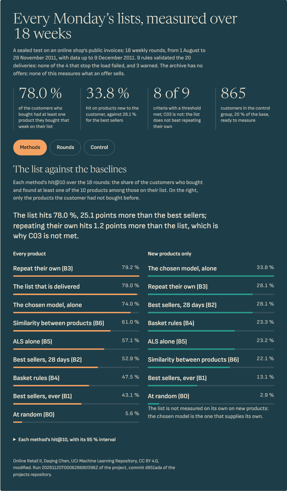
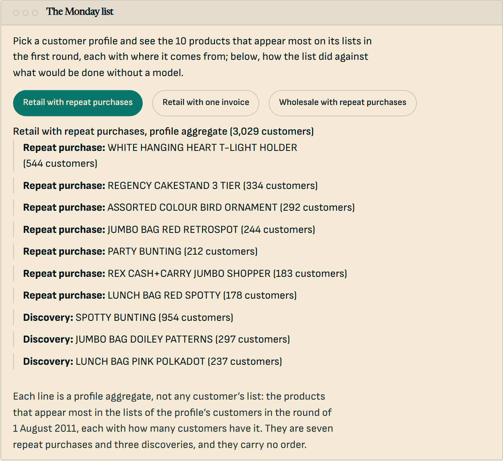
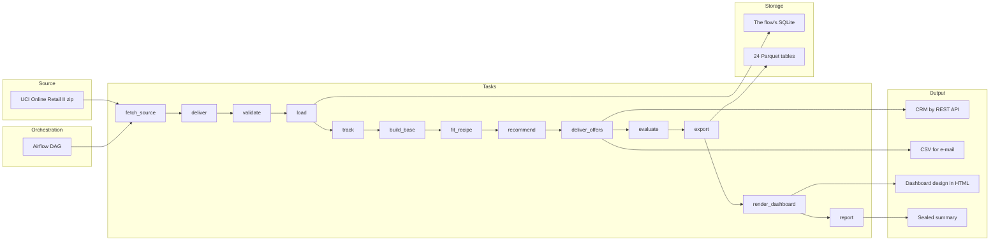

# An offer for every customer, built on its own

**English** · [Español](README.es.md)

A list of 10 products per customer every Monday, delivered to the CRM with a control group.



|  |  |
| --- | --- |
| **Result** | 8 of 9 success criteria met |
| **Tech stack** | Python, pandas, NumPy, SciPy, implicit, SQLite, Parquet, FastAPI, Apache Airflow, Docker |
| **Techniques** | Collaborative filtering (implicit ALS), Association rules, Cosine similarity, Stratified control group, CUPED, Permutation test, Bootstrap |
| **To audit** (in Spanish) | [Model card](docs/model-card.md) · [Independent evaluation](docs/evaluation.md) · [Evaluation results](reports/evaluation_summary.md) · [Decision log](docs/decisions.md) |

## 1. Executive summary

### 1.1 Business problem and solution

**Business problem and target audience.** Built for the marketing and CRM teams of an online shop that today send the same promotion to their whole base, though every customer buys different things, and that cannot build one offer per customer by hand. Every Monday the system builds a list of 10 products for each customer with a purchase in the last 365 days (4,326 customers at launch), on the public invoices of a UK online shop that also sells to wholesalers, keeps 20 % apart as a control group and delivers the others’ lists to the CRM through a REST API and to the e-mail tool in a CSV.

**Proposed solution.** A weekly recommendation engine that builds each customer’s list from three origins, every product marked with its own:

- **Repeat purchase (up to 7):** products the customer already bought, ordered by their own repurchase.
- **Discovery (at least 3):** products they never bought, from the chosen model: an implicit ALS blended with the best sellers of the last four weeks.
- **Fallback:** the best sellers of the last 28 days, when the model falls short of filling the 10.

### 1.2 Success criteria and impact

**Criteria set before measuring.** Before any code was written, nine criteria with a threshold were set, with what to expect of each. The list must beat the 28-day best sellers (C01) and lose no more than 5 points of hit@10 against repeating what the customer already buys (C02); beating that repurchase (C03) was expected probably not to happen. On products the customer never bought, the model must beat the best sellers (C04), and each customer must get their own list (C05). The control group must be balanced (C06), with a calibrated test (C07) that, with no offers, shows no difference that does not exist (C08), and what is delivered to the CRM must be what was decided (C09).

**Impact and main result.** On 18 weekly rounds nobody saw when the recipe was chosen, the list anticipated at least one product bought in the week for 78.0 % of the customers who bought, against 52.9 % for the 28-day best sellers; on products the customer had never bought, the model hit 33.8 % against 28.1 %. 8 of the 9 criteria are met: the list does not beat repeating what the customer already buys, which hits 79.2 % (C03 is not met). The archive has no offers, so the effect of an offer is not measured: the control group is ready to measure it once there is real data.



## 2. Datasets and preparation

### 2.1 Sources, scope and granularity

- Online Retail II. Daqing Chen, in UCI Machine Learning Repository. https://archive.ics.uci.edu/dataset/502/online+retail+ii (CC BY 4.0)

| Attribute | Specification |
| --- | --- |
| Original volume | 1,067,371 rows × 8 columns, across the two sheets of an Excel workbook (525,461 and 541,910 rows); after removing 22,523 copies from the overlap between sheets, 1,044,848 lines remain |
| Period covered | From 1 December 2009 to 9 December 2011, with each invoice’s date and time |
| Granularity and integrity | One row per invoice line (invoice, product, quantity, date and customer); the 11,812 repetitions within a sheet are kept and flagged |
| Customers and baskets | 5,852 customers with a purchase, 4,234 of them (72.4 %) on two invoices or more; 39,516 customer invoices and 2,922 guest invoices, with a median of 15 products per basket, over 4,877 distinct products |
| Unit of analysis | The pair (weekly round, customer): each round’s base is the customers with a purchase in the 365 days before its Monday, 4,326 at launch, 339 of them wholesalers |

<details>
<summary>Fields available in the dataset (8)</summary>

| Column | Content | Unit | Data type |
| --- | --- | --- | --- |
| `Invoice` | The invoice; a leading C is a cancellation and an A a debt adjustment. Never published | — | text or integer |
| `StockCode` | The product: it is one if it is five digits and up to three letters (D04); the rest are services, vouchers and discounts | — | text or integer |
| `Description` | The product’s description, in English; it may be empty (V16) | — | text |
| `Quantity` | The line’s units; negative on a cancellation | units | integer |
| `InvoiceDate` | Decides the delivery and the round: each purchase line counts in the window of a single week | — | date and time |
| `Price` | The unit price | pounds (£) | number |
| `Customer ID` | The customer; empty on one line in five (22.5 %), which are guests’ purchases. Never published or versioned | — | number or empty |
| `Country` | The invoice’s country; the United Kingdom holds 935,026 of the 1,044,848 lines | — | text |

</details>

None of the 8 columns is dropped: the flow adds the line’s key, the internal repetition flag and the role, and writes the 11 columns of the canonical line once. The invoice and the customer never leave the warehouse.

### 2.2 Cleaning and quality rules

- **Copies and repetitions.** The 22,523 exact copies from the overlap between the two sheets are removed. The 11,812 repetitions within a sheet are kept and flagged (V14, warning), because they may be two real lines (D03).
- **One role per line.** Each line gets the first of six roles it meets: 19,165 cancellations, 6 adjustments, 4,795 lines that are not products (services, vouchers and the 173 discount lines), 5,938 with no valid price or quantity (V15, warning), 226,757 guests’ purchases and 788,187 customers’ purchases. Cancellations are not subtracted from purchases (D03).
- **Missing values.** The customer is missing on 235,287 lines (22.5 %): they are guests’ purchases, which enter the basket rules and the best sellers, never as a customer who gets a list. An empty description is counted and kept (V16, warning, 4,275 rows).
- **Each delivery’s gate.** The 9 rules, V10 to V18, are 4 blocking ones that reject the delivery without touching the warehouse, 3 warnings and 2 informational ones. The real run’s 20 deliveries all loaded without a rejection.
- **No leakage.** No base, covariate, recommender or assignment reads a line from its round or later: the clock is the round (D23).
- **What the archive lacks.** The 173 discount lines are discounts on an invoice and not random offers (D43), and there are no product categories, costs or margins: the archive does not allow measuring the effect of an offer.

## 3. Architecture and methodology

The system runs as a flow of thirteen sequential tasks, the same from the command line (python -m personaloffers run) and from Apache Airflow’s personaloffers_weekly DAG in Docker: fetch_source → deliver → validate → load → track → build_base → fit_recipe → recommend → deliver_offers → evaluate → export → render_dashboard → report. As the archive is historical, the operation is simulated with a launch, 18 weekly deliveries and a close.

### 3.1 Source and ingestion

- **A pinned source (fetch_source).** The flow downloads nothing: it reads the UCI zip with its size (45,622,418 bytes) and its SHA-256 pinned, and treats the Excel workbook as an untrusted file, with decompression caps and no macros or external links. If a fingerprint is missing or does not match, the task ends without reading (D02).
- **Simulated deliveries (deliver).** With no source system, the task splits the archive into a launch, with the history up to 31 July 2011, 18 weekly deliveries and a close; each purchase line counts in the window of a single round, and with no delivery pending the run ends as no_delivery (D22).
- **Quality gate (validate).** Each delivery goes through rules V10 to V18 before it loads: the blocking ones reject it without touching the warehouse, the warnings count and keep what they flag, and the informational ones count the lines by role and the new customers and products.

### 3.2 Orchestration and transformation

- **Flow control (Apache Airflow).** The personaloffers_weekly DAG runs every Monday with the LocalExecutor, one run and one task active at a time, because the warehouse is a SQLite file with a single writer. A rejection of the source or the delivery fails the task with no retry; a network or disk error keeps its task’s retries (D26).
- **Transformation and base (load, track, build_base).** load writes each delivery to SQLite in a single transaction, all or nothing; track follows what each customer of the previous round bought, and build_base builds the round’s base, its covariates from what came before the Monday and the assignment to the control group.
- **Model and delivery (fit_recipe, recommend, deliver_offers).** Every Monday the sealed recipe is refitted on the history before that Monday, the lists of the whole base are built, the control’s included, which are never delivered, and they are sent to the CRM through its REST API, idempotent by round and contact and read back, and to the e-mail tool in a CSV (D11, D25).



### 3.3 Storage and data modelling

- **Transactional and audit database (SQLite).** A SQLite file holds the flow: the deliveries, the bases, the assignments, the lists, the follow-ups and each run with its rules’ verdict; the stand-in CRM has its own SQLite, and the canonical lines and the deliveries stay in Parquet (D24). The models are stored as .npy arrays with their SHA-256 and read without pickle (D13).
- **Star-schema analytical layer (Parquet).** The export task writes a star schema of 25 tables, 11 dimensions and 14 facts, with 20 one-to-many relationships that filter one way (D37). Each Parquet file carries the run key, the source’s fingerprint and the configuration’s in its metadata, and no published cell counts fewer than 10 customers (D30).

<details>
<summary>Data model (25 tables)</summary>

| Table | Kind | Columns | Joins |
| --- | --- | --- | --- |
| `Weekly round` | dimension | 4 | — |
| `Product` | dimension | 4 | — |
| `Where a product on the list comes from` | dimension | 2 | — |
| `Group: offer or control` | dimension | 2 | — |
| `Segment` | dimension | 2 | — |
| `Method` | dimension | 3 | — |
| `Variant` | dimension | 2 | — |
| `Run` | dimension | 11 | — |
| `Balance covariate` | dimension | 3 | — |
| `Criterion` | dimension | 3 | — |
| `Calendar` | dimension | 4 | — |
| `Each round’s operation` | fact | 10 | Weekly round (`round_key`) |
| `Follow-up by group and segment` | fact | 8 | Weekly round (`round_key`); Group: offer or control (`group_key`); Segment (`segment_key`) |
| `Products offered` | fact | 6 | Weekly round (`round_key`); Product (`product_key`); Where a product on the list comes from (`source_key`) |
| `Each customer’s list (private)` | fact | 7 | Weekly round (`round_key`); Product (`product_key`) |
| `Method by round` | fact | 11 | Weekly round (`round_key`); Method (`method_key`); Variant (`variant_key`) |
| `Method over the whole test` | fact | 14 | Method (`method_key`); Variant (`variant_key`) |
| `Method by segment` | fact | 9 | Segment (`segment_key`); Method (`method_key`); Variant (`variant_key`) |
| `Candidate recipes of the choice` | fact | 9 | — |
| `Balance of the control group` | fact | 5 | Balance covariate (`covariate_key`) |
| `The test’s A/A and calibration` | fact | 8 | — |
| `Smallest detectable effect` | fact | 7 | — |
| `Basket rules` | fact | 7 | — |
| `Each criterion’s verdict` | fact | 10 | Criterion (`criterion_key`) |
| `Validation rules` | fact | 8 | Run (`run_key`) |

</details>

### 3.4 Experimentation and machine learning

- **Rigour and traceability protocol.** The criteria C01 to C10 were set before any code was written, with what to expect of each, and every decision went into the decision log with its options, its reason and its status. The parameters, seeds and thresholds live in config/pipeline.toml, and before the test is opened the launch freezes in a seal the chosen recipe, the control group’s draw and the fingerprint of every configuration key that changes a sealed value: an evaluation with another configuration is refused before it writes (D21).

#### 3.4.1 Feature engineering and baseline

Every recommender reads only the history before its round’s Monday and returns a score per customer and product. The own repurchase adds the customer’s invoices with the product and half the relative recency of their last purchase; popularity counts distinct invoices, guests’ included; the pair rules take the highest confidence from a product the customer bought; implicit ALS and cosine similarity work on the customers-by-products matrix, and the blend adds to the model’s score, normalised per customer, a weight for the 28-day best sellers. The wholesaler mark is a stratum of the control and a reporting cut, never a model variable (D07), and a fixed tie-break order (score, popularity, code) gives the same lists byte for byte.

**What the list is measured against** (D18)

- **Selected alternative:** Seven baselines, with the own repurchase as the hardest. Random, global popularity, the 28-day best sellers, the own repurchase, rules, ALS and cosine, all with the same fallback and the same tie-break. Repeating what the customer already buys is what anyone can do without a model, and comparing with the weakest variant of the best sellers would exaggerate the advantage.
- **Rejected alternatives:** The 90-day best sellers, as in the research: It is weaker in the validation: on new products, 23.2 % against 30.9 % for the 28-day variant.
- **Rejected alternatives:** Comparing only with the best sellers: It is met almost surely and does not say whether the model adds anything to what anyone can do.

#### 3.4.2 Modelling decisions and ablation (ADR)

<details>
<summary>6 decisions, each with what was rejected</summary>

**Which recommenders compete** (D09)

- **Selected alternative:** Six recommenders as candidates and baselines, alone and blended with the trend. It measures what the product promises and lets the validation choose. The rules are computed with the project’s own co-occurrence matrix and a test checks them against mlxtend; ALS and cosine use implicit, with one thread and a fixed seed.
- **Rejected alternatives:** Basket rules alone, or ALS alone: In the validation, alone, they lose to the 28-day best sellers on new products; only the blend with the trend beats them.
- **Rejected alternatives:** A language model or RAG over the descriptions: It adds nothing to ranking products by purchases and cannot be audited against a baseline.

**How the discovery model is chosen** (D12)

- **Selected alternative:** A grid of 48 recipes measured only on the 13 validation rounds. ALS with 3 sizes and 2 regularisations, cosine with 3 neighbourhoods and rules with 3 supports, each with 4 trend weights. The highest hit@10 on new products wins and, within half a point of the best, the one with the highest coverage, so as not to choose a list that is nearly the same for everyone. It came out als_128_r0.1_w1, with 34.6 % in the validation: an optimistic figure, since it was chosen on the same rounds.
- **Rejected alternatives:** The research’s values, with no search: They left ALS at an unfair disadvantage.
- **Rejected alternatives:** A wide search with cross-validation over time: It costs more than the launch allows, about 5.6 s per round and candidate, and does not change what can be claimed.

**How much of the list is repeat purchase** (D10)

- **Selected alternative:** Up to 7 repeat purchases and the rest new. In the validation it costs about 2 points of hit@10 and leaves three new products a week for each customer. The 5-point margin of C02 is the price accepted.
- **Rejected alternatives:** 10 repeat purchases: It maximises the hits, but it is not a new offer.
- **Rejected alternatives:** 5 repeat purchases and 5 new: In the validation it hits 71.6 %, against 77.1 % for 7 and 3.
- **Rejected alternatives:** Choosing the mix in the validation: It would always choose 10 repeat purchases, because hits reward anticipating what the customer would buy anyway.

**How the control group is built** (D14)

- **Selected alternative:** 20 % of the launch cohort, in 18 strata, drawn once. Strata of recency, frequency and the wholesaler mark reduce the imbalance; whoever enters later is assigned by a hash function, which does not depend on who else entered, and nobody is reassigned. The control has a list that is never delivered: what it would have been offered.
- **Rejected alternatives:** Simple random: In an earlier period, 3.6 % of 500 draws passed a standardised difference of 0.10; with strata, none.
- **Rejected alternatives:** A new draw every week for whoever enters: A customer’s group would depend on who else entered that week.

**Which test will measure a campaign** (D15)

- **Selected alternative:** CUPED with a stratified permutation. The permutation is exact under the null hypothesis, and the archive, with no offers, is exactly that hypothesis; CUPED uses the earlier history without bias and lowers the smallest detectable effect.
- **Rejected alternatives:** The normal test on the values: Spend has a heavy tail: on the same 500 draws the unadjusted normal test rejects 1.4 % and 9.4 %, outside the band.
- **Rejected alternatives:** The logarithm of spend: It changes the question: it measures the geometric mean.
- **Rejected alternatives:** Trimming spend at a percentile: It throws away the wholesalers’ spend.

**What can be claimed with no offers in the archive** (D16)

- **Selected alternative:** Nothing: the balance, the A/A, the calibration and the smallest detectable effect are shown. No offer was sent in the archive. What does help a CRM team is knowing the size its first campaign needs.
- **Rejected alternatives:** Simulating a result and labelling it simulated: It puts an invented number on the site that someone would end up quoting.

</details>

#### 3.4.3 Validation protocol (backtesting)

Validation over time by weekly rounds, in two stretches that do not touch. The recipe is chosen on 13 validation rounds, from 2 May 2011 to 25 July 2011, and sealed before the test is opened: 18 rounds, from 1 August 2011 to 28 November 2011, evaluated once on 5,803 (round, customer) pairs of customers who bought in the week. Each round is built only from what came before its Monday, and the one of 5 December 2011 is censored because its week does not end in the archive. The 95 % intervals come from a paired resampling by customer, of 2,000 resamples with seed 0: a difference uses the same resamples.

### 3.5 Consumption and governance

- **Consumption interfaces.** The lists reach the CRM through its REST API and the e-mail tool in a CSV. The project page’s dashboard is drawn from the run’s sealed figures; the Parquet tables and the dashboard design in HTML, with five pages, are delivered with the project.
- **Governance artefacts.** The report task closes the run with the sealed summary of the criteria; the model card states the intended and unintended use, the data, the limits and the timings, and the decision log keeps each choice with its reason. An independent evaluation recalculated every figure with its own readers and found six blockers, none of which changes a verdict; they were fixed without touching the seal.
- **Lineage and privacy.** Every published file carries the run key, the source’s fingerprint and the configuration’s, and the site receives six JSON files with a manifest of each one’s size and SHA-256. No published file holds customer numbers (D30, D38).

## 4. Final product

### 4.1 Operational deliverables

- **Automation.** Every Monday a flow in Airflow builds each customer’s offers, keeps the control group apart and delivers them to a CRM through its REST API and to the email tool in a CSV: a local stand-in CRM, with 65,959 lists delivered and read back equal in 134 batches. Connecting a real CRM is still pending. The flow checks each delivery of data against 9 rules before loading it, and all 20 deliveries loaded without a rejection.
- **Model in use.** Each list has up to seven products from the customer’s own repurchases and three new ones from a model chosen on the validation, an implicit ALS of 128 factors blended with the best sellers of the last four weeks; when history is lacking, it is completed with the best sellers of those four weeks. Below are the 19 rounds, one at a time: how many customers of the base receive their list and how many stay as control. Then the control group, with its balance, the A/A, the calibration of the test and the smallest detectable effect, ready to measure once there is real data, and what reached the CRM and the email tool. No figure says how much an offer sells: the archive has no offers.
- **Dashboard.** Every Monday’s lists measured against the baselines, round by round, with the control group alongside, ready to measure once there is real data. The dashboard at the top is drawn from the run’s sealed figures; the tables, 24 in Parquet, and the dashboard’s design in HTML are delivered with the project.

### 4.2 Reading the current results

A snapshot of the real run, with data up to 9 December 2011:

- **Last test round.** In the round of 28 November 2011, 4,307 customers in the base: 3,467 receive their list and 840 stay as control. The list hit 78.5 % of the 470 customers who bought that week.
- **Rounds built.** 19 rounds, with between 4,268 and 4,372 customers in the base; each was built and delivered in between 23.3 and 27.3 seconds.
- **Delivery.** 65,959 lists of 10 products to the CRM in 134 batches, all read back equal, and 659,590 rows for the e-mail tool in 19 CSV files.

## 5. Conclusion

### 5.1 Evaluation against the success criteria

**Status:** 8 of 9 success criteria met.

**Not met:**

- C03, the list beats the own repurchase: the list hits 78.0 % and repeating what the customer already buys, 79.2 %; the 95 % interval of the difference, from −1.9 to −0.4 points, lies wholly below 0. It was expected probably not to be met.

The verdict against the nine criteria with a threshold set before building, in the executive summary (C10 is informational):

- **The list against the best sellers (C01).** It hits 78.0 % against 52.9 %: 25.1 points more, with a 95 % interval of 23.1 to 26.9 and a threshold of 0. Met.
- **The list against the own repurchase (C02).** It loses 1.2 points against repeating what the customer already buys, with an interval of −1.9 to −0.4, within the tolerated margin of 5 points. Met.
- **Discovery on new products (C04).** The chosen model hits 33.8 % against 28.1 % for the best sellers: 5.8 points more, with an interval of 4.6 to 7.0. Met, and better than in the validation, where the difference was 3.8 points.
- **Each customer, their own list (C05).** Each round’s lists cover on average 0.559 of the products bought in the previous 365 days, counted with basket lines, against a threshold of 0.10; with the preregistered definition, which counts only customers’ purchase lines, 0.588, computed after the seal. Met under both.
- **The control group (C06, C07 and C08).** The largest standardised difference of the five covariates is 0.048, with a maximum of 0.10; the preregistered test rejects 4.8 % and 6.2 % of 500 new draws, inside the band of 3.1 % to 6.9 %, and in the A/A gives p = 0.294 and p = 0.735, with a minimum of 0.05. Met: the control is ready to measure once there are real offers.
- **The delivery to the CRM (C09).** 65,959 of 65,959 lists were read back equal, no control customer reached the CRM or the e-mail files and repeating the last round created no record. Met.

**Comparison over the 18 test rounds**

| Method evaluated | Hit@10: the whole list / new products only | Role in the system |
| --- | --- | --- |
| The list that is delivered | 78.0 % / — | What reaches the CRM: repeat purchase, discovery and fallback |
| Own repurchase (B3) | 79.2 % / 28.1 % | The hardest baseline: the list does not beat it (C03) |
| Chosen model (ALS blended with the trend) | 74.0 % / 33.8 % | Discovery engine: the list’s new products |
| 28-day best sellers (B2) | 52.9 % / 28.1 % | Popularity baseline and the list’s fallback |
| Cosine similarity (B6) | 61.0 % / 22.1 % | Measured, not chosen: alone it does not beat the best sellers on new products |
| ALS alone (B5) | 57.1 % / 23.2 % | Measured, not chosen: alone it does not beat the best sellers on new products |
| Basket rules (B4) | 47.5 % / 23.3 % | They explain what is bought together; they do not enter the list |
| Global popularity (B1) | 43.1 % / 13.1 % | Baseline |
| Random (B0) | 5.6 % / 2.9 % | Reference floor |

### 5.2 Methodological limits

What was measured holds for a single UK online retailer, with a large share of wholesalers, between December 2009 and December 2011. The archive has no offers: how much an offer sells is not measured, and the control group is ready, balanced and calibrated, with no result to show. Repeating what the customer already buys is still the baseline that is not beaten (C03): the list’s value lies in the new products (C04) and in the coverage. The test falls between August and November and the validation between May and July, and how much of what the blend with the trend hits is season was not separated. There are no categories, costs or margins, whoever never bought gets no list, and the CRM is a local stand-in: its shape, its idempotency and its read-back were tested, never against a real CRM. The real run was made from the command line; the Airflow DAG in Docker was tested in quick mode, on a workbook of 300 fictional customers, in 80.1 s.

### 5.3 Future work

- **Measure a real campaign.** With offers sent, the control group already drawn and the preregistered test measure their effect. With a 20 % control, a campaign would have to move at least 0.76 points of weeks with a purchase or £227.83 of spend over the 18 weeks to be seen.
- **Connect a real CRM.** Mautic, HubSpot, Mailchimp or another need their URL, their keys and a smoke test against the real one; today the delivery was tested against the local stand-in.
- **A scheduled run on the real source.** Leave the weekly Airflow DAG running on the real source, which was tested in Docker in quick mode.
- **Separate the season.** Repeat the validation and the test with another window, to know how much of what the blend with the trend hits is season.

## Run it

Python 3.11, on PowerShell, from the repository folder:

```powershell
py -3.11 -m venv .venv
.venv\Scripts\python -m pip install -r requirements-dev.txt
.venv\Scripts\python -m pip check
$env:PYTHONPATH = "src"

# The source: size and SHA-256 of the zip checked before it is accepted, saved in data\raw\
.venv\Scripts\python research\s00_download.py

# Tests, without the ones that need the real source or Docker
.venv\Scripts\python -m pytest

# Quick run on a workbook of 300 made-up customers; everything stays in data\quick\
.venv\Scripts\python -m personaloffers make-fixture data\quick\online_retail_fixture.zip
.venv\Scripts\python -m personaloffers replay --config config\pipeline.quick.toml

# Real run: the launch, 18 weeks and the close, about 18 minutes
.venv\Scripts\python -m personaloffers replay
.venv\Scripts\python -m pytest -m real_data

# Airflow in Docker, with the stand-in CRM as a service
.venv\Scripts\python -m pytest -m docker

# The stand-in CRM by hand
$env:PERSONALOFFERS_CRM_TOKEN = "a-throwaway-value"
.venv\Scripts\python -m personaloffers serve-crm

# Documentation figures and the results block of README.es.md
.venv\Scripts\python -m personaloffers figures
.venv\Scripts\python -m personaloffers docs-sync
```

Every operation, with its failures and how to recover, is in the [runbook](docs/runbook.md) (in Spanish).

## Source and licence

Data: Chen, D. (2012). Online Retail II. UCI Machine Learning Repository. https://doi.org/10.24432/C5CG6D, CC BY 4.0 (https://creativecommons.org/licenses/by/4.0/). Copy used: `online_retail_ii.zip`, 45,622,418 bytes, SHA-256 `572e3627…7bfb`, size and hash checked before reading. Changes: the copies of the overlap between sheets removed, grouped by weekly round and summed up in aggregate figures; no published file carries customer numbers.

Libraries with their own licence: implicit 0.7.3 (MIT) and mlxtend 0.25.0 (BSD-3, only in tests). The raw data is not versioned.
