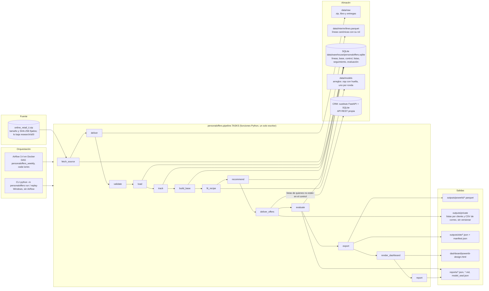

# Plan de implementación: una oferta para cada cliente, armada sola

Fecha: 2026-11-19. Lee primero `requirements.md` (RF, RNF, AC y los criterios C01-C10) y `decisions.md` (D01-D45). Este plan dice cómo construirlo; si un detalle no está aquí ni allí, la decisión vuelve a quien planifica: no se adivina. Las suposiciones se marcan como **[Supuesto]** y lo que hay que comprobar antes de escribir código, como **[Verificar]**.

Convenciones: documentación en español neutro; código, identificadores, tablas y columnas en inglés; medidas DAX, títulos de visuales y textos del sitio en español. Comandos para Windows (PowerShell) y el `.venv` del proyecto; rutas relativas a `08-Ecommerce-Personal-Offers/`. **El paquete se llama `personaloffers`** (variables de entorno `PERSONALOFFERS_*`, DAG de Airflow `personaloffers_weekly`, proyecto de Docker Compose `personaloffers-airflow`) y **el alcance de los commits es `personal-offers`** (por ejemplo `feat(personal-offers): …`, `test(personal-offers): …`; los documentos de planificación usan `docs(p08): …`, como pidió quien orquesta; D40). Cuando este plan dice «como el proyecto 07», el código de referencia es el de `07-Ecommerce-Invoices-ERP/` en su último commit corregido (`4770db3`), que se adapta y se copia, no se importa; «como el proyecto 04» se refiere a `04-Ecommerce-Churn-Risk/`, que usa el mismo archivo y el mismo calendario.

**Sin efecto de ofertas**: el archivo no tiene ofertas. Ninguna tabla, medida, JSON, figura ni texto de este proyecto tiene un campo o una frase de efecto, aumento o «lift» de una oferta (el «lift» de las reglas de asociación es otra cosa y se llama siempre `rule_lift`; D16).

## 1. Arquitectura



Principios (los de los proyectos 01 a 07, más los de sus evaluaciones):

- Cada tarea es una función `fn(ctx: RunContext) -> dict` sin dependencias del orquestador. El DAG de Airflow y la CLI recorren la misma tupla `TASKS` con las mismas funciones (D26).
- **Un solo escritor**: todo comando que escribe toma `data/interim/pipeline.lock` antes de su primera escritura (D29); el DAG falla sin escribir (`RunLockedError`, sin reintentos).
- Toda salida versionada se escribe con `files.write_atomic` (temporal, `fsync`, `os.replace`); los conjuntos de archivos llevan un manifiesto escrito al final. Una prueba estática exige que ningún módulo escriba un archivo versionado de otra forma (la sugerencia u22a/S1 del proyecto 07).
- **La ronda manda**: el grano de lo que se arma, se entrega y se evalúa es (ronda, cliente); la lista es filas (ronda × cliente × rango).
- **El reloj es la ronda** (D23): toda función que calcula algo para la ronda `r` recibe `history = lines[lines.invoice_date < r]` de `history_before(r)`, la única que corta; ningún recomendador, base, covariable ni asignación recibe el `DataFrame` entero. Lo de la semana `[r, r + 7)` solo lo lee `track` (seguimiento) y `evaluate`.
- **La lista es una**: `offers.build_list(...)` es la única que arma la lista; las líneas base B0-B6 se arman con los mismos recomendadores y la misma reserva, no con otro código.
- **El CRM es una interfaz**: `crm.client.CrmClient` habla la forma de la sección 18; el sustituto local la sirve en proceso (`httpx.ASGITransport`) o por HTTP (Docker).
- Los cálculos que terminan en un valor sellado reciben solo la **vista sellada** de la configuración (`SealedConfig`; D21).
- **Ningún número de cliente sale de `data/`, del CRM sustituto ni de `outputs/private/`** (D30).
- Toda ruta relativa se resuelve contra la carpeta del proyecto (`PERSONALOFFERS_HOME`), nunca contra el directorio de trabajo.
- **Nada sale a la red durante una corrida**: la descarga es de `research/s00_download.py`; el CRM es el configurado, local.

## 2. Estructura de carpetas

```text
08-Ecommerce-Personal-Offers/
  README.md
  pyproject.toml              # paquete personaloffers (src layout), pytest, marcas y la suite por defecto
  requirements.txt            # flujo y servicio: pandas, numpy, pyarrow, openpyxl, scipy, implicit, fastapi, uvicorn, httpx, matplotlib
  requirements-dev.txt        # -r requirements.txt, pytest, mlxtend (solo para la prueba que compara las reglas)
  requirements-research.txt   # el de la investigación (ya versionado)
  .gitignore                  # data/, .venv/, outputs/private/, airflow/logs/, airflow/config/, airflow/plugins/, airflow/.env, reports/validation/history/
  .dockerignore               # solo requirements*.txt, src/, sql/, config/ entran al contexto de la imagen
  config/
    pipeline.toml             # configuración completa (sección 4)
    pipeline.quick.toml       # modo rápido: extends = "pipeline.toml", todo bajo data/quick/
    pipeline.docker.toml      # el compose: extends = "pipeline.toml", [crm] mode = "http" contra el servicio crm
  sql/
    schema/001_core.sql  002_flow.sql  003_eval.sql
    marts/powerbi/
    checks/load/  checks/model/
  src/personaloffers/
    __init__.py  __main__.py  cli.py  config.py  pipeline.py  lock.py  sysinfo.py  files.py  texts.py
    sources.py  workbook.py  lines.py  calendar.py  deliveries.py  validate.py  warehouse.py
    base.py  holdout.py
    recommend/__init__.py  recommend/popularity.py  recommend/repeats.py  recommend/rules.py
    recommend/factor.py  recommend/blend.py  recommend/artifacts.py
    offers.py  choose.py  registry.py  launch.py  weekly.py  baselines.py
    metrics.py  experiment.py  evaluation.py  reporting.py
    crm/__init__.py  crm/client.py  crm/standin.py  email_export.py
    export.py  site_export.py  figures.py
    dashboard/__init__.py  dashboard/semantic_model.py  dashboard/render.py  dashboard/svg.py
  airflow/
    Dockerfile  docker-compose.yaml  .env.example  init.sh
    dags/personaloffers_weekly.py
  research/                   # s00-s07 de research.md, p01-p02 y sus salidas p01.out, p02.out (ya versionados)
  dashboard/powerbi-design.html          # generado (versionado)
  outputs/powerbi/*.parquet              # generado (versionado, ≤ 25 MB cada uno)
  outputs/site/*.json, manifest.json     # generado (versionado, ≤ 200 KB sin el manifiesto)
  outputs/private/                       # listas por cliente y CSV de correo (nunca versionado)
  reports/evaluation_summary.json|.md, reports/model_seal.json, reports/validation/latest.json|.md
  docs/  research.md requirements.md plan.md decisions.md
         data-dictionary.md model-card.md runbook.md paso-a-paso.md review-advisories.md evaluation.md figures/*.png
  tests/
    conftest.py               # accesorios de sesión y presupuesto de la suite (sección 24)
    fixtures/make_workbook.py  fixtures/hand_cases.py
    unit/  contract/  integration/  e2e/  docs/
  data/raw/  data/interim/  data/warehouse/  data/models/  data/crm/  data/quick/   # nunca versionados
```

Entorno (U01): el `.venv` ya existe con `requirements-research.txt`. U01 instala `requirements-dev.txt` encima y corre `pip check` (por su código de salida). Las pruebas y los comandos usan `PYTHONPATH=src`, como los proyectos 03 a 07. `conftest.py` fija `OPENBLAS_NUM_THREADS=1` y `MKL_NUM_THREADS=1` antes de importar implicit (implicit avisa y se vuelve lento con hilos de BLAS); el flujo los fija en `pipeline.py` y el compose en el entorno.

Marcas de pytest: `real_data` (el libro de UCI en `data/raw/`), `docker` y `slow` (informativa). Por defecto: `-m "not real_data and not docker"`.

## 3. Flujo de datos

Un lanzamiento, 18 entregas semanales y un cierre componen la historia (D05, D22); una corrida más termina como `no_delivery`. Una ronda es un lunes: su lista se arma con todo lo anterior a ese lunes y se mide con lo comprado en los 7 días siguientes.

| Entrega | Qué trae | `as_of` | Qué pasa además |
| --- | --- | --- | --- |
| `L2011-07-31` | La historia del 2009-12-01 al 2011-07-31 (unas 788.000 filas) | 2011-08-01 00:00 | Elige la receta en las 13 rondas de validación (R2011-05-02 a R2011-07-25), sortea el control sobre la cohorte, **sella el lanzamiento**, arma y entrega la ronda R2011-08-01 |
| `W2011-08-01` … `W2011-11-28` | Las líneas de su semana, de lunes a domingo (18 entregas) | 00:00 del lunes siguiente | Seguimiento de la ronda de esa semana; base, asignación de los nuevos, reajuste con la receta sellada, listas y entrega de la ronda del lunes siguiente (R2011-08-08 … R2011-12-05) |
| `C2011-12-05` | Las líneas del 2011-12-05 al 2011-12-09 | 2011-12-10 00:00 | Seguimiento censurado de R2011-12-05 (5 días, informativo); **evalúa la prueba una vez** (C01-C10, B0-B6, el A/A y su calibración) y la sella |

1. `fetch_source`: comprueba el zip y su miembro (V01, V02); si faltan las líneas canónicas o su huella de origen no coincide, lee el libro (V03-V07) y escribe `data/interim/lines.parquet` con su manifiesto al final.
2. `deliver`: publica la siguiente entrega pendiente en `data/raw/deliveries/<id>/lines.parquet` con su manifiesto (las líneas canónicas de su período, con su rol). Una semanal **comprueba que el sello tiene la parte `launch`** (si no, `RunRefusedError`, salida 2). Sin pendientes: `no_delivery`.
3. `validate`: reglas V10-V18 sobre la entrega. Con una regla bloqueante: corrida `rejected`, `ValidationError`.
4. `load`: se niega sin una validación aprobada de esta corrida; en una transacción inserta las líneas de la entrega y abre la fila de `pipeline_runs` como `running`.
5. `track`: en una semanal o en el cierre, para la ronda cuya semana acaba de llegar, escribe `round_outcomes` (por cliente de su base: compró, productos, productos de la lista, gasto) de solo inserción. En el lanzamiento no hace nada.
6. `build_base`: arma la base y las covariables de la ronda nueva con `history_before(r)` y escribe `contact_base`; en el lanzamiento, sortea el control de la cohorte (sección 8); en las semanales, asigna por la función hash a los que entran. En el cierre no hay ronda nueva.
7. `fit_recipe`: en el lanzamiento, la elección en validación (sección 11), los artefactos de la primera ronda y la parte `launch` del sello (sección 13). En las semanales, reajusta con la receta sellada sobre `history_before(r)`, guarda los arreglos con su huella y los registra en `model_registry`.
8. `recommend`: arma la lista de cada cliente de la base (sección 9.6) y las de las líneas base B0-B6 (sección 15), y escribe `offer_lists` y `baseline_lists` de solo inserción.
9. `deliver_offers`: manda al CRM las listas del grupo `offer`, lee de vuelta y escribe `crm_deliveries`; escribe el CSV de correo de la ronda (sección 12).
10. `evaluate`: solo en el cierre: evalúa la prueba y el experimento y escribe la parte `test` del sello, o comprueba que reproduce la sellada.
11. `export`: reconstruye los marts de Power BI, corre `sql/checks/model/` y exporta el modelo estrella, la tabla privada y los archivos del sitio.
12. `render_dashboard`: HTML del diseño desde la especificación y los Parquet exportados.
13. `report`: escribe `reports/evaluation_summary.*` y `reports/validation/latest.*` y cierra la corrida en el orden del proyecto 07 (SQLite `ok`, `dim_pipeline_run.parquet`, `summary.json` y el manifiesto, el HTML, la entrega `loaded`).

## 4. Configuración

`config/pipeline.toml`, leído con `tomllib`, con dataclasses congeladas y comprobación clave por clave como el proyecto 07: una sección o clave desconocida, una faltante, un tipo equivocado o un valor fuera de su dominio son `ValueError` con el nombre de la clave. **Cada clave tiene que cambiar algo o estar declarada informativa**, y una prueba lo mide por su efecto en la salida, no por su lectura en el código (la lección A9 del proyecto 07).

```toml
[source]                                   # D02
zip_path = "data/raw/online_retail_ii.zip"
zip_bytes = 45622418
zip_sha256 = "572e36277c2390fbfde10664750731e0a86f55e33470d91919085f0408e67bfb"
member = "online_retail_II.xlsx"
member_bytes = 45622278
member_sha256 = "bcbe73b35f5b7babf197fb0cb983a11f5d9ff929078d4aa53d171b1f2df2e980"
max_part_bytes = 400000000                 # tope descomprimido de cada parte del libro [Verificar en U04 con el real]
max_rows = 1200000
sheets = ["Year 2009-2010", "Year 2010-2011"]
columns = ["Invoice", "StockCode", "Description", "Quantity", "InvoiceDate", "Price", "Customer ID", "Country"]
first_date = 2009-12-01
last_date = 2011-12-09

[catalogue]                                # D04
product_code_regex = '^\d{5}[A-Za-z]{0,3}$'

[calendar]                                 # D05
history_start = 2009-12-01
launch_last_day = 2011-07-31
validation_first_round = 2011-05-02
validation_last_round = 2011-07-25
test_first_round = 2011-08-01
test_last_round = 2011-11-28
close_first_day = 2011-12-05
close_last_day = 2011-12-09
window_days = 7

[base]                                     # D06, D07
lookback_days = 365
bulk_min_median_qty = 24
bulk_min_lines = 3

[holdout]                                  # D14
share = 0.20
seed = 20110801
salt = "personal-offers-holdout-v1"
recency_bands = 3
frequency_bands = 3

[recommend]                                # D09, D10
k = 10
repeat_slots = 7
discovery_slots = 3
fallback_days = 28
repeat_recency_weight = 0.5
repeat_recency_days = 90

[grid]                                     # D12
als_factors = [32, 64, 128]
als_regularization = [0.01, 0.1]
als_iterations = 15
als_alpha = 20.0
cosine_k = [50, 100, 200]
rules_min_invoices = [5, 10, 20]
rules_min_lift = 1.0
blend_trend_weights = [0.0, 0.5, 1.0, 2.0]
blend_trend_days = 28
choice_tolerance = 0.005                   # medio punto de hit@10
seed = 0

[evaluation]                               # D20
resamples = 2000
seed = 0

[experiment]                               # D15
permutations = 2000
calibration_seeds = 500
calibration_permutations = 500
cuped_weeks = 18
alpha = 0.05
mde_power = 0.80
mde_shares = [0.10, 0.20, 0.30]

[criteria]                                 # preregistrados (requirements.md 8.1)
c01_min_diff_low = 0.0
c02_min_diff_low = -0.05
c03_min_diff_low = 0.0
c04_min_diff_low = 0.0
c05_min_coverage = 0.10
c06_max_abs_smd = 0.10
c07_rejection_band = [0.031, 0.069]
c08_min_p = 0.05

[crm]                                      # D25, D27
mode = "standin"                           # "standin" (en proceso) o "http"
base_url = ""
token_env = "PERSONALOFFERS_CRM_TOKEN"
batch_size = 500
timeout_s = 30
max_body_bytes = 2000000

[privacy]                                  # D30
min_cell_customers = 10

[site]
max_total_bytes = 204800

[paths]
raw_dir = "data/raw"
interim_dir = "data/interim"
warehouse = "data/warehouse/personaloffers.sqlite"
models_dir = "data/models"
crm_db = "data/crm/standin.sqlite"
outputs_dir = "outputs/powerbi"
private_dir = "outputs/private"
site_dir = "outputs/site"
reports_dir = "reports"
seal = "reports/model_seal.json"
dashboard_html = "dashboard/powerbi-design.html"
readme = "README.md"
figures_dir = "docs/figures"
```

**Qué entra en la huella del sello** (D21). `config.py` declara `FINGERPRINT_KEYS`, `UNSEALED_KEYS` e `INFORMATIVE_KEYS`; una prueba exige que cada hoja esté en exactamente una de las dos primeras (AC16).

- `FINGERPRINT_KEYS`: `source.zip_sha256`, `source.member_sha256`, `source.sheets`, `source.columns`, y todas las claves de `[catalogue]`, `[calendar]`, `[base]`, `[holdout]`, `[recommend]`, `[grid]`, `[evaluation]`, `[experiment]`, `[criteria]` y `[privacy]`. La huella agrega la huella observada de las líneas canónicas.
- `UNSEALED_KEYS`: el resto de `[source]` (rutas, tamaños, topes), `[crm]`, `[site]` y `[paths]`.
- **Nombres**: `config_sha256` es siempre la huella de la vista sellada; la del archivo TOML se llama `config_file_sha256` y solo aparece en el estado de la corrida.

`config/pipeline.quick.toml`: `extends = "pipeline.toml"`; `[source] zip_path = "data/quick/online_retail_fixture.zip"` con huellas vacías (la primera vista se registra en `data/quick/source.lock.json`, como el proyecto 07); `[calendar]` del accesorio (sección 24: validación de 2 rondas, prueba de 3, cierre de 5 días); `[grid]` con una sola opción por eje salvo `blend_trend_weights = [0.0, 1.0]`; `[evaluation] resamples = 200`; `[experiment] permutations = 200`, `calibration_seeds = 40`, `calibration_permutations = 100`; `[paths]` todas bajo `data/quick/`, incluidos el sello, el README, las figuras, el sitio, lo privado y el CRM. `_check` rechaza además: huellas vacías fuera de `data/quick/`; una ruta relativa que sale de la carpeta del proyecto; rondas que no son lunes; validación que no termina antes de `test_first_round`; `test_first_round` que no es el día siguiente a `launch_last_day`; `repeat_slots + discovery_slots` distinto de `k`; `share` fuera de (0, 0,5]; `c07_rejection_band` no creciente; un eje de la grilla vacío.

## 5. Almacenamiento

Tres lugares, cada uno para lo suyo (D24): **archivos** para el libro, las líneas canónicas y las entregas (`data/raw/`, `data/interim/lines.parquet`); **SQLite** del flujo para lo relacional; y **SQLite del CRM sustituto** (`data/crm/standin.sqlite`), que solo toca `crm/standin.py`. Reglas del runner (`warehouse.py`), las del proyecto 07: `journal_mode=DELETE`, `synchronous=FULL`, `foreign_keys=ON`; transacciones `BEGIN IMMEDIATE`; nunca `executescript()`; parámetros con nombre; deshacer ante un error.

`sql/schema/001_core.sql` (clave primaria entre paréntesis):

- `deliveries` (`delivery_id`): `kind` (`launch`, `weekly`, `close`), `first_day`, `last_day`, `as_of`, `rows`, `sha256`, `status` (`published`, `loaded`, `rejected`), `run_key`.
- `pipeline_runs` (`run_key`): `started_at`, `finished_at`, `status` (`running`, `ok`, `failed`, `rejected`, `no_delivery`), `delivery_id`, `as_of`, `config_sha256`, `round_id`, `peak_working_set_mb`, `memory_counter`, `message`.
- `validation_results` (`run_key`, `rule_id`): `name_es`, `severity`, `scope`, `aggregation`, `passed`, `rows_affected`, `examples_json` (claves de línea, nunca un número de cliente).
- `lines` (`line_key`): `delivery_id`, `invoice`, `stock_code`, `description`, `quantity`, `invoice_date`, `price` (texto decimal), `customer_id`, `country`, `internal_repeat`, `role`.
- `products` (`stock_code`): `description_es`, `first_seen`, `launch_invoices` (de la historia del lanzamiento).

`sql/schema/002_flow.sql` (de solo inserción con los tres disparadores del proyecto 07):

- `rounds` (`round_id`): `monday`, `period` (`validation`, `test`, `censored`), `built_by_run`, `base_size`, `offer_size`, `control_size`.
- `contact_base` (`round_id`, `customer_id`): `recency_days`, `invoices_365`, `spend_365`, `tenure_days`, `bulk`, `invoices_before` (todas), `segment` (`bulk`/`retail` × `one_invoice`/`repeat`).
- `holdout_assignments` (`customer_id`): `grp` (`offer`, `control`), `method` (`stratified`, `hash`), `stratum`, `assigned_round`, `run_key`.
- `model_registry` (`round_id`, `component`): `component` en `als`, `cosine`, `rules`, `popularity`; `params_json`, `artifact_path`, `artifact_sha256`, `fit_lines`, `seconds`.
- `offer_lists` (`round_id`, `customer_id`, `rank`): `stock_code`, `source` (`repeat`, `discovery`, `fallback`), `score`, `grp`, `run_key`.
- `baseline_lists` (`round_id`, `method`, `variant`, `customer_id`, `rank`): `stock_code`, `run_key`; `method` en `b0`-`b6` y `chosen_discovery`; `variant` en `unrestricted`, `new_only`.
- `round_outcomes` (`round_id`, `customer_id`): `bought`, `products`, `products_in_offer`, `spend` (texto decimal), `days_observed` (7, o 5 en la ronda censurada), `run_key`.
- `crm_deliveries` (`round_id`, `batch`): `contacts`, `created`, `unchanged`, `conflicts`, `readback_equal`, `seconds`, `run_key`.
- `round_ops` (`round_id`): `base`, `offer`, `control`, `new_assignments`, `lists`, `delivered`, `fallback_share`, `seconds`, `run_key`.

`sql/schema/003_eval.sql`: `eval_pairs` (`round_id`, `customer_id`, `method`, `variant`, `seal_state`: `hit`, `recall`, `precision`, `ndcg`, `test_products`); `eval_methods` (`method`, `variant`, `round_id` o `all`, `seal_state`: la tasa, el intervalo, la cobertura, los pares); `eval_experiment` (`metric`, `kind`, `seal_state`: diferencia, p, intervalo, tasa de rechazo, MDE); `eval_balance` (`covariate`, `seal_state`); `eval_criteria` (`criterion_id`, `seal_state`); `eval_choice` (`candidate`, `round_id` o `all`). `seal_state` en `sealed`, `post_seal`; las filas `sealed` son de solo inserción. `eval_pairs` tiene número de cliente y no sale de `data/` (la evaluación independiente la lee para recalcular: la lección A10 del proyecto 07).

## 6. Contrato de la fuente, las entregas y la validación

`sources.py` y `workbook.py` son la única fuente de los nombres: `SHEETS`, `COLUMNS` y los tipos esperados (`Invoice` texto o entero, `StockCode` texto o entero, `Quantity` entero, `InvoiceDate` fecha, `Price` número, `Customer ID` número o vacío) **[Verificar en U04 con el real cómo openpyxl entrega cada columna]**.

| ID | Severidad | Alcance | Agregación | Regla | Acción |
| --- | --- | --- | --- | --- | --- |
| V01 | bloqueante | fuente | source | El zip existe con su tamaño y su huella (o la registrada, en modo rápido); el tamaño se compara antes que la huella | Rechazo sin escribir; runbook R1 |
| V02 | bloqueante | fuente | source | Un solo miembro con el nombre exacto, sin rutas, con su tamaño y su huella | Rechazo; R1 |
| V03 | bloqueante | fuente | source | El libro como zip: cada parte ≤ `max_part_bytes` descomprimida, razón de compresión acotada, ninguna parte `vbaProject`, `externalLink` ni `activeX` | Rechazo |
| V04 | bloqueante | fuente | source | Las dos hojas con los nombres exactos y ninguna más | Rechazo |
| V05 | bloqueante | fuente | source | La primera fila de cada hoja tiene las 8 columnas exactas en su orden | Rechazo |
| V06 | bloqueante | fuente | source | Cada celda con su tipo; filas ≤ `max_rows` | Rechazo que nombra hoja y fila |
| V07 | bloqueante | fuente | source | Toda fecha entre `first_date` y `last_date` | Rechazo |
| V10 | bloqueante | entrega | per_run | La entrega es la siguiente del plan | Rechazo |
| V11 | bloqueante | entrega | per_run | Filas y SHA-256 son los del manifiesto de la entrega | Rechazo |
| V12 | bloqueante | entrega | per_run | Toda línea tiene su fecha dentro del período de la entrega | Rechazo |
| V13 | bloqueante | entrega | per_run | Ninguna `line_key` ya cargada | Rechazo |
| V14 | advertencia | línea | per_run | Repeticiones internas, contadas (se conservan) | Solo cuenta |
| V15 | advertencia | línea | per_run | Precio ≤ 0 o cantidad ≤ 0 fuera de anulaciones (rol `bad_price`) | Se aparta; cuenta |
| V16 | advertencia | línea | per_run | Descripción vacía | Se conserva; cuenta |
| V17 | informativa | entrega | per_run | Líneas por rol | Solo cuenta |
| V18 | informativa | entrega | per_run | Clientes y productos nuevos de la entrega | Solo cuenta |
| M01 | bloqueante | modelo | per_run | Ningún recomendador, base, covariable ni asignación recibe una línea de su ronda o posterior | `LeakageError` (D23) |
| M02 | bloqueante | modelo | per_run | Cada arreglo tiene la huella registrada antes de leerlo; solo `.npy` sin objetos | Falla la tarea (D13; R6) |
| M03 | advertencia | modelo | latest | La configuración es distinta de la sellada | Todo es `post_seal`; la evaluación sin sello de prueba se rechaza (D21) |
| M04 | bloqueante | modelo | latest | Ninguna candidata se calculó con una línea desde `test_first_round` | Detiene el lanzamiento (R5) |
| M05 | bloqueante | modelo | per_run | Ningún cliente del control en un lote para el CRM ni en el CSV | Falla la tarea antes de mandar (D14) |
| M06 | bloqueante | modelo | per_run | Cada lista tiene 10 productos distintos con su origen | Falla la tarea |

Entregas (`deliveries.py`): el plan sale de `[calendar]`. Identificadores `L<launch_last_day>`, `W<lunes>`, `C<close_first_day>`. Manifiesto `data/raw/deliveries/manifest.json` con versión, escrito con `write_atomic`.

## 7. Base de contactos, covariables y segmentos (`base.py`; D06, D07)

```python
def history_before(lines: pd.DataFrame, monday: date) -> pd.DataFrame   # la única que corta; las líneas con invoice_date < monday
def contact_base(history, monday, view) -> pd.DataFrame                 # clientes con una compra en [monday - 365, monday)
def covariates(history, base_ids, monday, view) -> pd.DataFrame         # recency_days, invoices_365, spend_365, tenure_days, bulk, invoices_before
def segment(row) -> str                                                  # "bulk|repeat", "retail|one_invoice", ...
```

- Solo cuentan las líneas `purchase` (con cliente). La marca `bulk` es la regla del proyecto 02 (mediana de unidades por línea ≥ 24 con ≥ 3 líneas en los 365 días anteriores), usada **solo** como estrato del control y corte de informe, nunca como variable de un modelo (D07, D39).
- Los compradores de una semana que no están en la base (primeras compras o clientes sin compras en el último año; de 20 a 36 por semana en la validación, `p01`) se cuentan en `round_ops` y en C10; ninguna lista los alcanza.

## 8. Grupo de control (`holdout.py`; D14)

```python
def strata(cov: pd.DataFrame, view) -> np.ndarray                       # terciles de recencia (por rango) x terciles de facturas x bulk: hasta 18
def assign_cohort(cov, view) -> pd.DataFrame                             # en el lanzamiento, una vez
def assign_newcomer(customer_id: int, view) -> str                       # sha256(salt + ":" + id)[:8] / 2**64 < share
def smd(x, control: np.ndarray) -> float
def balance(cov, assignment) -> dict[str, float]                         # las cinco covariables
```

- **El lanzamiento**: la cohorte es la base de R2011-08-01. Los terciles se cortan por rango (`rank(method="first")`), así que no dependen de empates. Dentro de cada estrato, en orden de `customer_id`, una permutación de `numpy.random.default_rng(seed)` (un generador para toda la cohorte, recorriendo los estratos en orden) pone en el control los primeros `round(share × n)`. El equilibrio (C06) se calcula en ese momento y va al sello.
- **Los que entran después** van por la función hash: ningún sorteo se repite y la asignación de un cliente no depende de quién más entró.
- **Persistente**: `holdout_assignments` es de solo inserción; una prueba exige que repetir el lanzamiento y cada semanal no cambie ninguna fila.
- **El control tiene lista** (`offer_lists` con `grp = "control"`), que nunca se entrega (M05): en una operación real, esa lista es lo que se habría ofrecido y permite el análisis por intención de tratar (D14).

## 9. Recomendadores (`recommend/`, `offers.py`)

Todos reciben `history` (de `history_before`), la base y la vista sellada, y devuelven una matriz densa `float32` de puntajes (clientes de la base × catálogo de la ronda: unas 4.300 × 4.600, unos 80 MB). Las matrices se calculan de a una, se convierten en listas y se liberan antes de la siguiente (RNF03). El catálogo de la ronda son los productos con alguna línea `purchase` o `guest_purchase` en la historia. El desempate es fijo: puntaje, después popularidad global, después `stock_code` (D11).

### 9.1 Popularidad (`recommend/popularity.py`)

Facturas distintas con el producto (las de invitados incluidas), en toda la historia (B1) o en los últimos `days` días antes del lunes (B2 con 28 días, la reserva de la lista, y la tendencia de la mezcla). La de 28 días es la más fuerte en la validación (`p01`: 30,9 % solo nuevos contra 23,2 % la de 90 días; D18).

### 9.2 Recompra propia (`recommend/repeats.py`)

El puntaje de la investigación: facturas del cliente con el producto + `repeat_recency_weight` × (fecha de la última − (lunes − `repeat_recency_days`)) / `repeat_recency_days`. Solo productos que el cliente compró.

### 9.3 Reglas de asociación (`recommend/rules.py`)

Pares de productos sobre todas las canastas de la historia (las de invitados incluidas), desde una matriz dispersa de coocurrencia: soporte en facturas ≥ `min_invoices`, lift > `rules_min_lift`; el puntaje de un producto para un cliente es la mayor confianza desde un producto que el cliente compró. Las reglas guardan `support`, `confidence` y `rule_lift`. Una prueba compara las confianzas con `mlxtend` (`fpgrowth` y `association_rules`) en el accesorio, a 1 × 10⁻⁹ (la investigación lo hizo en el real, diferencia máxima 1,1 × 10⁻¹⁶). La matriz densa del catálogo real es de unas 4.600 × 4.600: se calcula en `float32` y se libera al terminar (unos 85 MB) **[Verificar en U09]**.

### 9.4 Factorización y vecinos (`recommend/factor.py`)

`implicit.als.AlternatingLeastSquares(factors, regularization, iterations, alpha, random_state=seed, num_threads=1, use_gpu=False)` sobre la matriz binaria cliente × producto (todos los clientes de la historia, CSR); `implicit.nearest_neighbours.CosineRecommender(K, num_threads=1)`. El puntaje de un cliente es su fila de factores por los de los productos (ALS) o su fila por la matriz de similitud (coseno). `p01` comprobó que ALS reajustado con un hilo y la misma semilla da factores idénticos; U09 lo fija en una prueba con el accesorio.

### 9.5 Mezcla con la tendencia (`recommend/blend.py`)

`blend = base / max(base del cliente) + w × pop28 / max(pop28)`, donde `base` es ALS, coseno o reglas, recortado a ≥ 0; `w` en `blend_trend_weights` (0 es el modelo solo). En `p01`, ALS con `w = 1` sube de 21,2 % a 34,7 % en productos nuevos y le gana a lo más vendido de 28 días por 3,8 puntos (D12).

### 9.6 La lista (`offers.py`; D10)

```python
def build_list(repeat_scores, discovery_scores, seen, fallback_order, view) -> tuple[np.ndarray, np.ndarray]   # (productos, origen) por cliente
```

Para cada cliente: hasta `repeat_slots` productos que compró, por su puntaje de recompra; después, hasta llegar a `k`, productos que nunca compró con puntaje de descubrimiento > 0, por ese puntaje (son al menos `discovery_slots`, y más si la recompra da menos de 7); después, la reserva (popularidad de 28 días) sin repetir, hasta `k`. Es la regla que midió `p01` (77,1 % con la mezcla de ALS y la tendencia), salvo que `p01` usó la reserva de 90 días. C04 no depende de cuántos lugares tome el descubrimiento: compara la lista solo nuevos de 10 del modelo elegido (`chosen_discovery`, sección 15) con la de B2. **[Supuesto]**: con una sola factura previa, la mayoría de los clientes tiene más de 7 productos (mediana de 15 por factura). M06 comprueba 10 distintos con su origen.

### 9.7 Artefactos (`recommend/artifacts.py`; D13)

Cada componente ajustado se guarda en `data/models/<round_id>/<component>/` como arreglos `.npy` (factores, matriz de similitud en `data`/`indices`/`indptr`, reglas) y un `artifact.json` con el tamaño y la huella de cada archivo; se escribe con `write_atomic` y se registra en `model_registry`. Se lee solo si la huella coincide, con `numpy.load(allow_pickle=False)`; un `.pkl`, `.pickle`, `.npz` con objetos o un archivo no listado se rechaza (M02). Las listas emitidas son el registro: los arreglos existen para la trazabilidad y para la evaluación independiente.

## 10. Sin fuga de información (D23)

- `history_before` es la única que corta; los recomendadores, `contact_base`, `covariates` y `assign_cohort` reciben su resultado. `LeakageError` si una de ellas recibe una línea con fecha ≥ su lunes (M01), comprobado en ejecución y con una prueba estática que exige que esos módulos no llamen a `read_lines` ni a `warehouse.lines`.
- **Prueba de truncamiento** (AC07, AC13): las listas, la base, las covariables y la asignación de una ronda son idénticas byte a byte si se borran todas las líneas desde su lunes, y si se cambian las cantidades de una línea posterior.
- **La popularidad** se cuenta solo en la historia (la fuga de 56,3 % a 58,9 % de la investigación).
- **Los invitados** entran solo en las reglas y la popularidad (AC08).
- **Una ventana por línea** (AC18): las semanas de las rondas no se pisan; una prueba recorre las 18 rondas y cuenta cada línea de compra una vez a lo sumo.
- **La validación termina antes de la prueba** (M04): `choose.py` recibe solo líneas con fecha < `test_first_round`; la última semana de validación termina el 2011-07-31.
- **El sello va antes** (AC16): `deliver` de una semanal se niega sin la parte `launch` del sello, y el sello se escribe antes de entregar R2011-08-01.

## 11. Elección en validación (`choose.py`; D12)

Candidatas del descubrimiento: cada combinación de un modelo base (ALS con `als_factors` × `als_regularization`; coseno con `cosine_k`; reglas con `rules_min_invoices`) y un peso `w` de `blend_trend_weights`: (6 + 3 + 3) × 4 = 48. Para cada una y cada ronda de validación (R2011-05-02 a R2011-07-25): ajuste con `history_before(r)`, lista **solo nuevos** de 10 para cada cliente evaluado y hit@10 sobre los pares evaluados de la ronda.

**Regla**: se elige la de mayor hit@10 solo nuevos, sobre los pares de las 13 rondas (media por par); entre las que quedan a menos de `choice_tolerance` (medio punto) de la mejor, la de mayor cobertura de descubrimiento; si sigue el empate, la de menor `w`, después la más simple (reglas, coseno, ALS) y después el menor número de factores o de vecinos. Las líneas base B4-B6 toman, cada una, su mejor parámetro con `w = 0` por la misma regla. Cada candidata guarda su cifra por ronda y en total con `fit_rounds`. **Lo que no se elige**: `repeat_slots`, `discovery_slots`, la reserva y la ventana son decisiones del producto (D10), no de la validación.

Tiempo: unos 0,4 s por ajuste de coseno, 1,6 s por ALS y 2,4 s por la coocurrencia de una ronda (`p01`); con la coocurrencia una vez por ronda y la grilla de arriba, unas 13 × (2,4 + 6 × 1,6 + 3 × 0,4) ≈ 172 s de ajuste, más el armado de las listas. **[Supuesto]**: el lanzamiento entero, con la lectura del libro, cabe en 20 minutos (RNF02).

## 12. Entrega al CRM y al correo (`crm/`, `email_export.py`; D25, D45)

```python
class CrmClient:                                     # forma de la sección 18
    def put_offers(self, round_id, contacts: list[ContactOffers]) -> BatchResult   # idempotente
    def read_round(self, round_id) -> Iterator[ContactOffers]                     # pagina por offset y limit
def deliver_round(conn, client, round_id, view) -> DeliveryResult                 # lotes de batch_size, lectura de vuelta, M05
def write_email_csv(conn, round_id, path, view) -> Path                           # outputs/private/email/<round_id>.csv
```

- Un lote repetido igual devuelve `unchanged`; un lote con una lista distinta para una clave ya cargada devuelve 409 `list_conflict` y no cambia nada (una lista emitida no cambia). Una respuesta perdida (tiempo agotado después de que el CRM guardó) se reintenta una vez con el mismo lote y da `unchanged`: no duplica (la lección A4 del proyecto 07). Un error que no es 409 deja `crm_deliveries` con el lote fallido y la tarea falla después de intentar todos los lotes; repetirla manda solo lo que falta.
- La lectura de vuelta pagina por `offset` y `limit` en el orden de la clave, y una prueba siembra más de dos páginas para comprobar que no repite ni saltea (la lección `0462f72` del proyecto 07).
- El CSV tiene `contact_id`, `rank`, `stock_code`, `description_es`, `source`; nunca filas del control (M05). Vive en `outputs/private/`, fuera de lo versionado.

## 13. Lanzamiento congelado y sello (`registry.py`, `launch.py`)

```python
def sealed_view(cfg, observed_hashes: dict) -> SealedConfig
def config_fingerprint(view) -> str
def seal_state(seal_path, config_sha256) -> Literal["none", "match", "post_seal"]
def write_launch_seal(seal_path, launch: dict) -> None          # creación exclusiva; una vez
def write_test_seal(seal_path, test: dict) -> None              # una vez; se relee y se compara
def check_test_evaluation(seal_path, view) -> Literal["first", "repeat", "post_seal"]   # o EvaluationRefusedError
def fit_recipe(ctx) -> dict                                      # la tarea: elección y sello en el lanzamiento; reajuste en las semanales
```

- **Qué se congela antes de abrir la prueba** (D21): la vista sellada de la configuración (calendario, base, control, recomendadores, grilla, lista, evaluación, experimento, criterios, privacidad); la huella del zip, del libro y de las líneas canónicas; la elección con la cifra de cada candidata por ronda y `fit_rounds`; la receta elegida y los parámetros de B4-B6; la asignación de la cohorte (su huella, sus tamaños por estrato y por grupo) y su equilibrio (C06); la huella de las listas de R2011-08-01; `validation_digest`. **No se congela**: los factores de cada semana (se reajustan con la receta sellada; D11).
- **Orden** (las correcciones A5 y A7 del proyecto 07): la elección y los artefactos candidatos se escriben en `data/models/.candidates-<run_key>/`, que se conserva si algo falla; el sello se escribe **antes** de registrar el modelo; si el registro falla después del sello, `fit_recipe` siguiente adopta lo sellado sin repetir la elección (`mode=adopt`), y `run --run-key <corrida> --from fit_recipe` es la recuperación nombrada en el runbook R6 y probada.
- **Reglas del sello**, las del proyecto 07: sin sello, el lanzamiento escribe `launch`; con sello y el mismo `config_sha256`, comprueba `validation_digest`, la elección y la huella de la asignación (distintos: `SealMismatchError`, R7); con otro, todo es `post_seal` (M03); la evaluación con otra configuración mientras el sello no tiene `test` se rechaza antes de escribir; ninguna parte se reescribe.

## 14. Ronda semanal (`weekly.py`)

`run_round(conn, client, run, view)`: para la entrega de la semana `[s, s + 7)`: `track` de la ronda `R<s>` (seguimiento, de solo inserción); con `r = s + 7`: `build_base`, `fit_recipe` (reajuste), `recommend` (lista y líneas base), `deliver_offers`. Todo en transacciones que leen dentro qué ya está emitido y **no lo tocan**; se niega (`ScoringError`) a emitir una ronda que no es la de su entrega. Mide los segundos de cada paso y escribe `round_ops`.

**Prueba en seco del tiempo semanal y del cierre** (la lección B4 del proyecto 07: el tiempo del cierre se descubrió recién en la corrida real): al terminar U12, quien la construye corre las rondas de validación del real (antes del 2011-08-01, nunca la prueba) en una copia temporal y anota los segundos por ronda; y al terminar U14, corre el A/A y su calibración sobre el período previo del real (como `p02`, antes del 2011-08-01) y anota los segundos. Si una ronda pasa de 45 s o la calibración de 180 s, la unidad siguiente lo corrige antes de U21.

## 15. Líneas base (`baselines.py`; D18)

Todas se arman con los recomendadores de la sección 9, la misma reserva y el mismo desempate, sobre los mismos pares: **B0** al azar (semilla de `[evaluation]`), **B1** popularidad global, **B2** popularidad de 28 días, **B3** recompra propia completada con B2, **B4** reglas, **B5** ALS, **B6** coseno (B4-B6 con su mejor parámetro de la elección y `w = 0`); además `chosen_discovery`, el modelo elegido, para C04. Cada una tiene sus dos variantes (sin restricción y solo nuevos). Se emiten con cada ronda en `baseline_lists`: lo evaluado es lo emitido, no un cálculo nuevo en el cierre (la lección B2 del proyecto 07: una línea base que lee algo distinto de lo que vería en la operación).

## 16. Evaluación, criterios y resumen (`metrics.py`, `evaluation.py`, `reporting.py`)

Cohorte, definiciones y umbrales: `requirements.md`, sección 8.1. **Lo que se evalúa es lo que se emitió**: las cifras salen de `offer_lists`, `baseline_lists`, `round_outcomes`, `contact_base` y `holdout_assignments`, unidas en `eval_pairs`.

- `evaluate_rankings(conn, view) -> RankingResult`: para cada método, variante y ronda de prueba, hit@10, recall@10, precisión@10, NDCG@10, cobertura y pares; los totales; los intervalos por remuestreo de clientes (2.000, semilla 0) y las diferencias pareadas de C01-C04 con los mismos remuestreos; Wilson informativo; los cortes por segmento.
- `evaluate_experiment(conn, view) -> ExperimentResult`: la sección 17.
- `evaluate_criteria(result, view)` y `criteria_from_seal(seal)` comparten `_criteria_of` como en el proyecto 07: `criterion_id`, `tested_value` (**la cantidad que el umbral compara**: el límite inferior en C01-C04, la cobertura en C05, la mayor diferencia en C06, las dos tasas en C07, los dos p en C08, las tres cuentas en C09; la lección A1 del proyecto 07), `point_value`, `ci_low`, `ci_high`, `threshold_es`, `passed`, `seen_by_research`, `seen_by_planner`, `verdict_es`. Cada veredicto **nombra su comparación** y su unidad: «En 18 rondas semanales, la lista acertó al menos un producto en el 76,0 % de los clientes que compraron y lo más vendido en el 54,0 %; el límite inferior de la diferencia es 19,5 puntos y el umbral era 0» (cifras de ejemplo, no medidas).
- Una sola definición por criterio (la lección B1 del proyecto 07): `tests/unit/test_reporting.py::test_each_criterion_uses_its_preregistered_quantity_and_unit` arma cada criterio desde un caso a mano con el texto de la sección 8.1 y falla si el denominador o la unidad cambian.
- `write_summary(...)`: celdas con `|` escapado; cada cifra con `texts.es()`; `docs-sync` copia el bloque entre `<!-- results:start -->` y `<!-- results:end -->` del README. La tabla tiene la columna «Lo que prueba el umbral» (no «Valor»).
- Antes del cierre, el resumen dice «La prueba se evalúa con el cierre del 2011-12-10» y muestra las cifras de validación rotuladas con sus rondas.
- Después del sello, un almacén sin las filas selladas toma C01-C09 de `criteria_from_seal`, cada uno reconstruido a 6 decimales o `SealError`. El tablero y los Parquet llevan el mismo texto de veredicto que el resumen (la lección N2 del proyecto 07).
- Lo que guarda el cierre para la evaluación independiente, en `data/` (no versionado): `eval_pairs` completo y las listas de la prueba de todos los métodos.

## 17. El experimento preparado (`experiment.py`; D15, D16)

```python
def outcomes(lines_window, cohort, weeks: list[date]) -> tuple[np.ndarray, np.ndarray]   # M1 (parte de semanas con compra), M2 (gasto)
def cuped(y, x) -> tuple[np.ndarray, float]
def stratified_permutation(y, control, strata, permutations, rng) -> PermResult          # diferencia oferta − control, p a dos colas, la desviación de las permutaciones
def calibrate(y1, y2, cov, view) -> Calibration                                         # 500 sorteos nuevos con assign_cohort y semillas 1..500
def mde(sd, n_offer, n_control, alpha, power) -> float
```

- **La unidad** es el cliente de la cohorte del lanzamiento; los que entran después no están en el análisis (entraron con la prueba empezada). **El período** son las 18 semanas de prueba; **el previo** (CUPED), las 18 semanas anteriores al lanzamiento.
- **C07, calibración**: cada sorteo nuevo usa `assign_cohort` con otra semilla (el mismo procedimiento sellado), y la prueba con `calibration_permutations`; la tasa de rechazo de M1 y la de M2 deben quedar en la banda. `p02`: 4,2 % y 4,4 % en el período previo; la normal sin ajustar del gasto, 7,8 %.
- **C08, el A/A sellado**: la prueba preregistrada con el control sellado y `permutations`. Se informan también las pruebas normales sin ajustar (C10) para mostrar por qué no se usan: en `p02`, con el sorteo de semilla 0, marcaron +0,71 puntos y +165,65 £ sin que hubiera efecto.
- **El MDE** con 10, 20 y 30 % de control, desde la desviación de M1 y M2 con CUPED de la prueba: es lo que el sitio puede decir de una operación de este tamaño, no un efecto.
- **Lo que no se calcula**: ninguna diferencia entre grupos se presenta como efecto; los nombres de campos y medidas dicen `aa_` (A/A), nunca `effect`, `uplift` ni `lift` (D16; AC23, AC28).
- Tiempo: la calibración de `p02` tardó 76,7 s con 4.320 clientes y 500 permutaciones; la cohorte del lanzamiento tiene unos 4.300 **[Inferido de `p01`: bases de 4.313 a 4.330]**.

## 18. Servicios locales (`crm/standin.py`; D25, D27)

```text
PUT  /api/v1/rounds/{round_id}/offers        -> cuerpo {"contacts": [{"contact_id": int, "offers": [{"rank": 1, "stock_code": "85123A", "source": "repeat"}, ...]}]}
                                                 (a lo sumo batch_size contactos y max_body_bytes); 200 con {"created", "unchanged"}; 409 list_conflict si una clave ya tiene otra lista
GET  /api/v1/rounds/{round_id}/offers?offset=0&limit=500  -> {"data": [...], "total": n} en el orden de contact_id
GET  /api/v1/contacts/{contact_id}/offers?round_id=R...   -> la lista de ese contacto en esa ronda
GET  /health                                 -> {"status": "ok"} (también pide el token)
```

`create_app(cfg, env)` lee el token del entorno (`crm.token_env`); sin token, la aplicación no arranca. Cada pedido sin `Authorization: Bearer <token>` o con otro es 401 (`hmac.compare_digest`, antes de mirar la ruta, con `WWW-Authenticate: Bearer`); los errores son `{"code": …}` con una palabra fija (`unauthorized`, `not_found`, `bad_request`, `payload_too_large` 413, `list_conflict` 409, `internal_error`), sin rutas ni trazas; un `round_id` que no cumple `R\d{4}-\d{2}-\d{2}` es 404 sin tocar la base; sin página de documentación ni esquema. `python -m personaloffers serve-crm` se niega a otro host que `127.0.0.1` y a un puerto fuera de 1-65535 (salida 2), como el proyecto 07; en Docker corre uvicorn con la fábrica en la red interna, sin puertos publicados. **No hay API de entrada** (D27): el disparo manual de Airflow y la CLI son la entrada.

## 19. Salidas: modelo estrella

Parquet, uno por tabla, con metadatos `personaloffers.run_key`, `personaloffers.as_of`, `personaloffers.config_sha256` y `personaloffers.attribution`. Todo va a `outputs/powerbi/` (versionado) salvo `fact_offer_customer`, que va a `outputs/private/` (no versionado). Ninguna tabla versionada tiene una columna de cliente; toda celda que cuenta clientes tiene 10 o más, con la regla secundaria del proyecto 04 (D30).

Dimensiones (clave en negrita):

| Tabla | Columnas |
| --- | --- |
| `dim_date` | **`date_key`** int32, `date`, `week_monday`, `period` (`history`, `validation`, `test`, `close`) |
| `dim_round` | **`round_key`**, `monday`, `period` (`validation`, `test`, `censored`), `days_observed` |
| `dim_product` | **`product_key`** (`stock_code`), `description_es`, `first_seen`, `popularity_band` (decil de facturas en la historia del lanzamiento) |
| `dim_method` | **`method_key`** (`offer_list`, `chosen_discovery`, `b0`-`b6`), `label_es`, `role_es` |
| `dim_variant` | **`variant_key`** (`unrestricted`, `new_only`), `label_es` |
| `dim_source` | **`source_key`** (`repeat`, `discovery`, `fallback`), `label_es` |
| `dim_group` | **`group_key`** (`offer`, `control`), `label_es` |
| `dim_segment` | **`segment_key`** (`bulk|repeat`, `bulk|one_invoice`, `retail|repeat`, `retail|one_invoice`), `label_es` |
| `dim_covariate` | **`covariate_key`**, `label_es`, `unit_es` |
| `dim_criterion` | **`criterion_key`**, `name_es`, `threshold_es` |
| `dim_pipeline_run` | **`run_key`** y las columnas de `pipeline_runs` |

Hechos:

| Tabla | Grano | Columnas |
| --- | --- | --- |
| `fact_round_ops` | ronda | `round_key`, `base`, `offer`, `control`, `new_assignments`, `delivered`, `fallback_share`, `buyers_outside_base`, `seconds` |
| `fact_round_group` | ronda × grupo × segmento | `round_key`, `group_key`, `segment_key`, `customers`, `buyers`, `buyers_of_listed`, `spend` (celdas < 10 ocultas) |
| `fact_offer_product` | ronda × producto × origen | `round_key`, `product_key`, `source_key`, `offered_to`, `bought_by` (solo filas con `offered_to` ≥ 10) |
| `fact_method_round` | método × variante × ronda | `method_key`, `variant_key`, `round_key`, `pairs`, `hit_rate`, `recall`, `precision`, `ndcg`, `coverage`, `seal_state` |
| `fact_method_total` | método × variante | `method_key`, `variant_key`, `pairs`, `hit_rate`, `ci_low`, `ci_high`, `wilson_low`, `wilson_high`, `recall`, `precision`, `ndcg`, `coverage`, `seal_state` |
| `fact_segment` | método × variante × segmento | `method_key`, `variant_key`, `segment_key`, `pairs`, `hit_rate`, `ci_low`, `ci_high`, `seal_state` |
| `fact_choice` | candidata | `candidate`, `base_model`, `params`, `trend_weight`, `val_hit_new`, `val_coverage`, `kept`, `chosen`, `fit_rounds` |
| `fact_balance` | covariable | `covariate_key`, `offer_mean`, `control_mean`, `smd` |
| `fact_experiment` | métrica × prueba | `metric` (`m1`, `m2`), `test` (`preregistered`, `normal_raw`, `normal_cuped`), `aa_diff`, `aa_p`, `aa_ci_low`, `aa_ci_high`, `calibration_rejection`, `seal_state` |
| `fact_mde` | métrica × parte del control | `metric`, `holdout_share`, `holdout_size`, `mde`, `mde_relative` |
| `fact_rule` | regla de pares | `antecedent_key`, `consequent_key`, `support`, `confidence`, `rule_lift` (las 200 de mayor lift con soporte ≥ 20 en la historia del lanzamiento) |
| `fact_evaluation_summary` | criterio | `criterion_key`, `tested_value_es`, `point_value`, `ci_low`, `ci_high`, `passed`, `seen_by_research`, `seen_by_planner`, `verdict_es`, `seal_state` |
| `fact_validation` | corrida × regla | `run_key`, `rule_id`, `name_es`, `severity`, `scope`, `aggregation`, `status`, `rows_affected` |
| `fact_offer_customer` (privado) | ronda × cliente × rango | `round_key`, `customer_id`, `rank`, `product_key`, `source_key`, `group_key`, `bought` |

Relaciones: uno a varios, filtro unidireccional de la dimensión al hecho, todas activas.

| ID | Dimensión (1) | Hecho (*) |
| --- | --- | --- |
| R01-R05 | `dim_round[round_key]` | `fact_round_ops`, `fact_round_group`, `fact_offer_product`, `fact_method_round`, `fact_offer_customer` |
| R06-R07 | `dim_product[product_key]` | `fact_offer_product`, `fact_offer_customer` |
| R08-R10 | `dim_method[method_key]` | `fact_method_round`, `fact_method_total`, `fact_segment` |
| R11-R13 | `dim_variant[variant_key]` | `fact_method_round`, `fact_method_total`, `fact_segment` |
| R14 | `dim_source[source_key]` | `fact_offer_product` |
| R15 | `dim_group[group_key]` | `fact_round_group` |
| R16-R17 | `dim_segment[segment_key]` | `fact_round_group`, `fact_segment` |
| R18 | `dim_covariate[covariate_key]` | `fact_balance` |
| R19 | `dim_criterion[criterion_key]` | `fact_evaluation_summary` |
| R20 | `dim_pipeline_run[run_key]` | `fact_validation` |

`fact_rule` no tiene relación (dos claves de producto; se muestra como tabla) **[Supuesto: U15 decide si agrega relaciones inactivas con `USERELATIONSHIP`]**. Tamaño: el hecho mayor es `fact_offer_product` (unas 19 rondas × unos 1.500 productos × 3 orígenes, menos las filas ocultas); todo cabe en unos pocos MB.

## 20. Diseño del tablero (HTML)

`dashboard/semantic_model.py` es la única fuente (tablas, columnas, relaciones, medidas y páginas); `render.py` y `svg.py` se adaptan de los del proyecto 07: autocontenido, sin recursos externos ni scripts, todo texto con `html.escape`, segmentadores que declaran qué filtran y títulos con «(no lo filtra …)» si ninguna relación alcanza el visual.

Medidas (en `_Medidas`; las de la prueba leen solo filas `sealed`):

```dax
Clientes en la base = SUM ( fact_round_ops[base] )
Reciben oferta = SUM ( fact_round_ops[offer] )
Grupo de control = SUM ( fact_round_ops[control] )
Listas entregadas = SUM ( fact_round_ops[delivered] )
Parte de reserva = AVERAGE ( fact_round_ops[fallback_share] )
Acierto (hit@10) = CALCULATE ( SELECTEDVALUE ( fact_method_total[hit_rate] ), fact_method_total[seal_state] = "sealed" )
Acierto por ronda = CALCULATE ( AVERAGE ( fact_method_round[hit_rate] ), fact_method_round[seal_state] = "sealed" )
Límite inferior = CALCULATE ( SELECTEDVALUE ( fact_method_total[ci_low] ), fact_method_total[seal_state] = "sealed" )
Cobertura = CALCULATE ( AVERAGE ( fact_method_round[coverage] ), fact_method_round[seal_state] = "sealed" )
Ofrecido a = SUM ( fact_offer_product[offered_to] )
Comprado por = SUM ( fact_offer_product[bought_by] )
Mayor diferencia estandarizada = MAXX ( fact_balance, ABS ( fact_balance[smd] ) )
Rechazo del A/A = CALCULATE ( SELECTEDVALUE ( fact_experiment[calibration_rejection] ), fact_experiment[test] = "preregistered", fact_experiment[seal_state] = "sealed" )
p del A/A = CALCULATE ( SELECTEDVALUE ( fact_experiment[aa_p] ), fact_experiment[test] = "preregistered", fact_experiment[seal_state] = "sealed" )
Menor efecto detectable = SELECTEDVALUE ( fact_mde[mde] )
Veredicto = CALCULATE ( SELECTEDVALUE ( fact_evaluation_summary[verdict_es] ), fact_evaluation_summary[seal_state] = "sealed" )
Última fecha de cálculo = CALCULATE ( MAX ( dim_pipeline_run[as_of] ), dim_pipeline_run[status] = "ok" )
Reglas bloqueantes fallidas = CALCULATE ( COUNTROWS ( fact_validation ), fact_validation[severity] = "bloqueante", fact_validation[status] = "falla" )
```

`validate_model` (como el del proyecto 07) exige que cada referencia exista, que el texto con que se compara una columna esté en su descripción, que ninguna medida quite filtros, que las de la prueba pidan `sealed` y que ningún nombre diga efecto, aumento o «uplift». Por eso U16 es de riesgo alto (ítem 6).

Páginas (grilla de 12 por 9), todas con la leyenda «Sin ofertas reales: el archivo no permite medir el efecto de una oferta»:

1. **Las ofertas de la semana**. Segmentadores: ronda, segmento. Tarjetas: Clientes en la base, Reciben oferta, Grupo de control, Listas entregadas, Parte de reserva. Barras por ronda (oferta y control); los productos más ofrecidos por origen.
2. **La lista contra las líneas base**. Segmentadores: variante, segmento. Acierto con su intervalo de cada método; línea del acierto por ronda de la lista, B2 y B3; la tabla de recall, precisión y NDCG.
3. **Productos nuevos y cobertura**. Acierto solo nuevos del modelo elegido frente a B2; cobertura por método; la elección en validación (`fact_choice`); las reglas de mayor lift con su soporte y confianza.
4. **El grupo de control, listo para medir**. El equilibrio por covariable; el A/A con su p y la tasa de rechazo de la calibración, frente a la prueba normal; el menor efecto detectable con 10, 20 y 30 %; la leyenda «Esto no es un efecto».
5. **La prueba y la calidad de datos**. Tabla C01-C10 con su cifra, umbral, lo visto y el veredicto; tarjetas Reglas bloqueantes fallidas y Última fecha de cálculo; la tabla de reglas y la de corridas.

## 21. Exportación para el sitio (`site_export.py`)

Seis archivos en `outputs/site/` y al final `manifest.json`; el procedimiento de escritura, `read_site` y `verify_site` son los del proyecto 07. **Envoltorio común**: `schema_version` (1), `run_key`, `as_of`, `config_sha256`, `source_sha256`, `attribution` (la cita de RNF10), `no_effect_note_es` («El archivo no tiene ofertas: estas cifras dicen qué anticipa cada lista, no cuánto vende una oferta»).

- **`summary.json`**: `status`, `evaluation_status` (`pending`, `sealed`, `post_seal`); `headline` (`rounds`, `base_mean`, `offer_mean`, `control_mean`, `hit_offer_list`, `hit_b2`, `hit_b3`, `hit_new_chosen`, `hit_new_b2`, `coverage`, `max_abs_smd`, `aa_p_m1`, `aa_p_m2`, `mde_m1_points_20`, `mde_m2_gbp_20`), floats a 3; `criteria[]` (los 10, en orden); `seal`; `sealed_from` si corresponde.
- **`data.json`** (Datasets): las filas del archivo, las copias quitadas, las filas sin cliente y su parte (una de cada cinco), los roles, los países, los productos, las canastas (mediana de productos), las facturas de invitados, los clientes con dos o más facturas, la recompra, la mediana entre compras, los mayoristas por la regla del proyecto 02 al lanzamiento, las 173 líneas de descuento `D` (no son ofertas al azar) y el calendario (lanzamiento, rondas, cierre).
- **`algorithms.json`** (Algoritmos como una historia: repetir lo propio ya acierta mucho; lo más vendido no es personal; la lista mezcla recompra y descubrimiento; el descubrimiento le gana a lo más vendido solo con la tendencia): `methods[]` (B0-B6, el modelo elegido y la lista, con acierto, intervalo, recall, precisión, NDCG y cobertura, sin restricción y solo nuevos); `by_round[]`; `choice[]` (las candidatas con su cifra de validación); `rules_example[]` (10 reglas de pares con descripción, soporte, confianza y `rule_lift`, elegidas por regla fija: las de mayor lift con soporte ≥ 50); `example_lists[]` (tres listas de ejemplo **sin cliente**: los 10 productos con su origen para un perfil descrito por segmento, elegidos por regla fija entre clientes de segmentos con ≥ 10 clientes, sin ningún dato que permita identificarlos) **[Supuesto: si la evaluación juzga que una lista puede identificar a un cliente, se reemplaza por una lista armada para un perfil sintético]**.
- **`operation.json`** (Producto final: las 19 rondas): `rounds[]` (`monday`, `base`, `offer`, `control`, `delivered`, `fallback_share`, `buyers`, `buyers_of_listed` por grupo, `seconds`); `crm` (`lists`, `created`, `unchanged`, `conflicts`, `readback_equal`); `email` (archivos y filas, sin contenido).
- **`control.json`** (el grupo de control): `holdout` (parte, estratos, tamaños por grupo); `balance[]`; `aa` (las dos métricas con la prueba preregistrada y las normales sin ajustar, diferencia, p e intervalo); `calibration` (tasas y banda); `mde[]` (10, 20 y 30 %); `what_it_cannot_measure_es[]`.
- **`validation_rules.json`**: `rules[]` en el orden de la sección 6, agregadas según su columna, y `totals`.

**Antes del sello, nada de la prueba**: criterios, métodos, A/A, calibración y MDE van `null` o vacíos hasta `evaluation_status = sealed`; `rounds[]` muestra las rondas ya corridas (es seguimiento) sin las cifras de acierto. Contrato: `tests/contract/test_site_export.py` y `tests/integration/test_published_bytes.py` (ninguna ruta local, ningún número de cliente, ninguna celda de menos de 10 clientes, ningún campo de efecto). El sitio copia estos archivos: cambiar su forma después es de riesgo alto (ítem 3).

## 22. Orquestación

```python
TASKS: tuple[TaskSpec, ...] = (
    TaskSpec("fetch_source", fetch_source), TaskSpec("deliver", deliver, short_circuit=True), TaskSpec("validate", validate),
    TaskSpec("load", load), TaskSpec("track", track), TaskSpec("build_base", build_base), TaskSpec("fit_recipe", fit_recipe),
    TaskSpec("recommend", recommend), TaskSpec("deliver_offers", deliver_offers), TaskSpec("evaluate", evaluate),
    TaskSpec("export", export), TaskSpec("render_dashboard", render_dashboard), TaskSpec("report", report),
)
```

**Estado, cierre y rechazos** (el diseño del proyecto 07 con sus correcciones; D28): `data/interim/runs/<run_key>.json` con cada tarea (filas, segundos, picos de memoria con su contador, `config_file_sha256`, la traza si falla); la corrida queda `running` hasta que `report` la cierra en orden; una falla después de `load` deja `failed` y reescribe lo exportado; el manejador de fallas intenta cada escritura por separado y relanza el error de la tarea. Rechazos antes de escribir (`RunRefusedError`, salida 2), en este orden: una tarea de una corrida `ok` o `no_delivery`; `deliver` en una corrida con otra entrega; toda tarea desde `load` de una corrida sin entrega, incluida `task <tarea>` sin `--run-key`; `load` si otra corrida cargó la entrega o sin una validación aprobada; `track` a `deliver_offers` si la entrega no es la última cargada; `deliver` de una semanal sin el sello del lanzamiento; `evaluate` con otra configuración mientras el sello no tiene `test`; `replay` o `run` con una reconstrucción a medias (R11, la corrección B3 del proyecto 07).

**Un solo escritor** (`lock.py`, D29): el del proyecto 07 tal cual, con `PERSONALOFFERS_*`.

**DAG** `airflow/dags/personaloffers_weekly.py` (Airflow 3: `from airflow.sdk import DAG, task`; D26): `dag_id="personaloffers_weekly"`, `schedule="0 6 * * 1"` (cada lunes a las 6), `start_date` 2026-11-02 UTC, `catchup=False`, `max_active_runs=1`, `max_active_tasks=1`, `tags=["personaloffers"]`; una tarea por `TaskSpec`, `@task.short_circuit` para `deliver`. Cada tarea llama a `pipeline.run_task(task_id, run_id)`, la misma función que usa la CLI; un `ValidationError`, un `SourceError`, un `LeakageError` y un `RunRefusedError` fallan con `AirflowFailException`, sin reintentos; el resumen que cada tarea publica en XCom corta el texto a 200 caracteres y vuelve `None` un número no finito (como el 07). La corrida a mano es el disparo manual de Airflow. Como el archivo es histórico, cada disparo corre la siguiente entrega pendiente, no la semana del calendario real.

**Docker** (`airflow/`, D26): como el proyecto 07 (D58 del 07), con `PERSONALOFFERS_*`. `Dockerfile` `FROM apache/airflow:3.4.0@sha256:a8d9d19c563c768b2bc605ef26440f28a9164ea886064e99c599b057432ff572` (el resumen de los proyectos 04 a 07, verificado en `07-Ecommerce-Invoices-ERP/airflow/Dockerfile`), `USER airflow`, `requirements.txt` junto con `apache-airflow==3.4.0` **[Verificar en U20 que implicit 0.7.3 tiene rueda para la imagen (Linux, Python de la imagen) y que `pip check` queda limpio]**; contexto = la carpeta del proyecto con `.dockerignore`. `docker-compose.yaml` (`name: personaloffers-airflow`) copiado del corregido del proyecto 07: LocalExecutor, PostgreSQL con versión y resumen, la interfaz solo en `127.0.0.1:8080`, `src/`, `sql/`, `config/` y `data/raw/` montados de solo lectura en `/opt/personaloffers`, `PYTHONPATH=/opt/personaloffers/src`, `PERSONALOFFERS_HOME=/opt/personaloffers`, `PERSONALOFFERS_CONFIG`, `OPENBLAS_NUM_THREADS=1`; más un servicio `crm` de la misma imagen en la red interna (el sustituto con uvicorn y `--factory`, el único que escribe `data/crm/standin.sqlite` en Docker; el DAG lo usa con `config/pipeline.docker.toml`, `[crm] mode = "http"`, `base_url = "http://crm:8001"`). Cada secreto sin valor por defecto, con `${VAR:?}` y sin `env_file` (cada servicio recibe solo lo que nombra): `PERSONALOFFERS_DB_PASSWORD` (también en la cadena de conexión), `PERSONALOFFERS_FERNET_KEY`, `PERSONALOFFERS_JWT_SECRET`, `PERSONALOFFERS_ADMIN_PASSWORD` y `PERSONALOFFERS_CRM_TOKEN`; `init.sh` con `set -euo pipefail` y sin retornos de carro (una prueba lo lee en bytes, no en modo texto: la lección de U21 del 07); `.env.example` lista las claves vacías y cómo generarlas. La prueba `tests/e2e/test_airflow_docker.py` (marca `docker`): genera claves de usar y tirar, escribe el modo rápido en `data/quick/`, construye, corre `pip check` en la imagen (por su código de salida) y `airflow dags test personaloffers_weekly` dos veces (el lanzamiento rápido y la primera semanal), comprueba que el sello no cambió entre las dos y que **la segunda entregó listas al CRM y no duplicó ninguna** (a diferencia del 07, el modo rápido sí entrega: las listas no necesitan un modelo grande), baja los servicios con `--volumes`, borra lo que creó y compara los listados de Docker antes y después.

**CLI** (`cli.py`, `__main__.py`):

```text
python -m personaloffers run [--config RUTA] [--only TAREA ...] [--from TAREA] [--run-key CLAVE] [-v]
python -m personaloffers replay [--config RUTA] [--until ENTREGA] [-v]
python -m personaloffers task TAREA [--config RUTA] [--run-key CLAVE] [-v]
python -m personaloffers make-fixture SALIDA_ZIP [--seed 0]
python -m personaloffers serve-crm [--config RUTA] [--host 127.0.0.1] [--port 8001]
python -m personaloffers figures [--config RUTA]
python -m personaloffers docs-sync [--config RUTA]
```

Códigos de salida: 0 (también `no_delivery` y un `replay` sin pendientes), 1 falla de una tarea, 2 uso, configuración, corrida rechazada, bloqueo tomado o reconstrucción a medias, 3 entrega o fuente rechazada. Salen con 2 antes de escribir las combinaciones del proyecto 07 (`--only` con `--from`, `--run-key` sin selección, `task <tarea desde load>` sin `--run-key`, `--until` que no es del plan o ya está cargada haya o no otra pendiente, tarea desconocida, `docs-sync` sin README). `docs-sync` llena el bloque del README **y** las tablas del diccionario (la desviación de U23 del 07 que quedó sin cerrar). `cli.main(argv) -> int` es la entrada de las pruebas.

## 23. Módulos y funciones públicas

Las firmas son el contrato con las pruebas; los detalles internos quedan a quien programa. Las de la base, el control, los recomendadores, la lista, la elección, el CRM, el sello, la ronda, las líneas base, la evaluación y el experimento están en las secciones 7 a 17.

```python
# config.py
@dataclass(frozen=True)
class PipelineConfig: source; catalogue; calendar; base; holdout; recommend; grid; evaluation; experiment; criteria; crm; privacy; site; paths; project_root: Path
@dataclass(frozen=True)
class SealedConfig: ...
FINGERPRINT_KEYS: tuple[str, ...]; UNSEALED_KEYS: tuple[str, ...]; INFORMATIVE_KEYS: tuple[str, ...]
def load_config(path: Path | None = None) -> PipelineConfig

# sources.py, workbook.py, lines.py
class SourceError(RuntimeError): ...
def check_sources(cfg) -> dict[str, str]                                 # V01-V02; devuelve las huellas
def inspect_workbook(path, view) -> WorkbookCheck                         # V03 sin abrir con openpyxl
def read_workbook(path, view) -> pd.DataFrame                             # V04-V07; openpyxl read_only
def canonical_lines(raw: pd.DataFrame, view) -> pd.DataFrame              # copias, repeticiones, line_key, role
def read_lines(cfg) -> pd.DataFrame                                       # el Parquet canónico, comprobado por su manifiesto

# calendar.py, deliveries.py, validate.py, warehouse.py
def rounds(view, period) -> list[date]; def window(monday, view) -> tuple[datetime, datetime]
def delivery_plan(view) -> list[DeliverySpec]; def next_pending(manifest, plan) -> DeliverySpec | None
def validate_delivery(spec, path, conn, view, *, run_key) -> ValidationReport
def connect(path) -> sqlite3.Connection; def apply_schema(conn) -> None; def run_checks(conn, group) -> list[CheckResult]

# reporting.py, export.py, site_export.py, dashboard, figures.py, texts.py, files.py
def write_summary(criteria, result, reports_dir, seal_path) -> tuple[Path, Path]
def sync_block(path, start_marker, end_marker, content) -> bool
def export_star_schema(conn, out_dir, private_dir, model, run, view, *, seal_path) -> list[Path]
def export_site(conn, out_dir, run, view, *, seal_path, max_total_bytes) -> list[Path]
def read_site(out_dir) -> SiteFiles; def verify_site(out_dir) -> list[str]
def render_design(model, parquet_dir, html_path, run_meta) -> Path
def write_figures(site_dir, out_dir) -> list[Path]
def es(value, decimals, *, percent=False) -> str
def write_atomic(path: Path, data: bytes) -> None

# pipeline.py, lock.py, sysinfo.py
@dataclass(frozen=True)
class RunContext: cfg; run_key: str; started_at: datetime; state_path: Path
def run_task(task_id, run_id=None, cfg=None) -> dict; def run_all(cfg, only=None, start=None, run_key=None) -> list[dict]
def replay(cfg, until=None) -> list[list[dict]]
class UsageError(ValueError): ...; class RunRefusedError(RuntimeError): ...; class RunLockedError(RunRefusedError): ...
@contextmanager
def sole_writer(interim_dir, command, run_key) -> Iterator[Holding]
def peak_memory() -> MemoryPeaks
```

## 24. Estrategia de pruebas

La prueba primero en cada unidad: se escribe la RED de la sección 27, se ve fallar por la razón esperada (no por un error de importación), se escribe el código, se ve pasar y se corre la suite. Cada prueba afirma todos los efectos observables (salida, código de salida, filas, archivos) por la interfaz pública. Para cada comando u opción existente que una unidad toque, una prueba de que lo anterior sigue igual. El estado temporal (`tmp_path`, `HOME`, `TMPDIR`) queda fuera del árbol de trabajo; **ninguna prueba escribe en el árbol del proyecto** (la lección `c135752` del 07: una prueba de `--config` corrió `figures` sobre la carpeta real y reescribió `docs/figures`): `conftest.py` toma una huella de los archivos versionados al empezar la sesión y la compara al terminar.

- **Accesorio** (`tests/fixtures/make_workbook.py`): un libro con las dos hojas reales y las 8 columnas, escrito con openpyxl, determinista por semilla; unas 6.000 filas de 300 clientes ficticios (`90001`-`90300`) y 400 productos ficticios (`90000`-`99999`, descripciones «PRODUCTO SINTÉTICO n»), con una semana de solapamiento entre hojas, invitados, anulaciones, ajustes, códigos que no son producto, precios cero, repeticiones internas y compras que se repiten; un calendario propio que `pipeline.quick.toml` declara (historia del 2010-12-06 al 2011-03-27, con la semana del 2010-12-06 en las dos hojas; validación de 2 rondas, R2011-03-14 y R2011-03-21; prueba de 3 rondas, R2011-03-28 a R2011-04-11; la ronda censurada R2011-04-18 y el cierre del 2011-04-18 al 2011-04-22); y `make_malformed(base, kind)` con `extra_member`, `renamed_member`, `macro_part`, `external_link`, `zip_bomb_part`, `extra_sheet`, `missing_sheet`, `extra_column`, `missing_column`, `reordered_columns`, `wrong_type`, `date_out_of_range`, `too_many_rows`, `wrong_hash`.
- **Casos a mano** (`tests/fixtures/hand_cases.py`): popularidad, recompra, reglas (soporte, confianza y lift de un caso de cinco canastas), ALS y coseno con un orden esperado en una matriz de 6 × 8, la lista (siete de recompra, tres nuevos, reserva, un cliente de una factura), las métricas (hit, recall, precisión, NDCG, cobertura, el remuestreo por cliente), el experimento (SMD, CUPED, una permutación con su p exacto en 8 clientes de dos estratos, el MDE) y la elección con tres candidatas.
- **Mutaciones**: cada unidad con una regla de negocio deja escrita una comprobación de mutación.
- **Diferencial**: cuando una unidad cambia código compartido (el runner de SQL, la CLI, el envoltorio de tareas, el bloqueo, `build_list`, `history_before`, `CrmClient`), corre el comando afectado contra una copia del commit anterior en una carpeta de `mktemp -d` y compara salida, errores y código de salida.
- **Real** (`real_data`): recuentos de AC03 y AC04, la lectura del libro con su tiempo, las rondas de validación (repiten parte de `p01`) y la corrida completa en U21. **Ninguna prueba `real_data` anterior a U21 lee una línea desde el 2011-08-01**: leen con el mismo filtro de `p01` y lo afirman.

### 24.1 El tiempo de la suite rápida, planificado desde el principio (D31)

El proyecto 07 planificó 92 s y terminó en 125 s (L105 a L116 del registro); el 06, en 133 s con el límite subido a 180 s. Aquí el presupuesto se reparte desde el principio con más margen:

- **Límite**: ≤ **180 s** (AC40; el que el dueño fijó en el 06, tomado como vigente: **[Supuesto]**, pendiente 13 de la sección 29). **Presupuesto de trabajo**: **120 s**. **Total previsto: 80 s**, con 40 s de margen. **Disparador temprano**: después de cada unidad, quien la construye corre la suite por defecto dos veces y anota «N pasaron en X s»; si X pasa de **100 s**, la unidad siguiente es una de velocidad, antes de seguir; una unidad que suma más de 1,5 veces lo previsto en la tabla de abajo dice por qué en su decisión.
- **Una sesión que pasa el límite falla** (`tests/unit/test_suite_budget.py::test_a_full_default_session_over_the_limit_fails_and_says_by_how_much`) e imprime las diez pruebas más lentas.
- **Los accesorios de sesión** se arman una vez: `workbook` (el libro sintético en un directorio de la sesión), `launched` (el lanzamiento rápido), `replayed` (el lanzamiento, tres semanales y el cierre). Las pruebas que cambian algo trabajan sobre copias. Los cachés de los accesorios se indexan por la ruta completa y la configuración (la sugerencia speed/S1 del 07: un caché que devolvía la carpeta de la primera llamada).
- **implicit y BLAS con un hilo**; implicit se importa solo en `recommend/factor.py` y dentro de las funciones.

| Unidad | Segundos previstos que suma | De dónde |
| --- | ---: | --- |
| U01-U02 | 2 | Estáticas y configuración |
| U03 | 3 | El libro sintético una vez por sesión |
| U04 | 3 | Lectura del libro y sus 14 variantes |
| U05 | 3 | Roles, calendario, entregas y validación |
| U06 | 2 | Almacén |
| U07 | 3 | Base, covariables y truncamiento |
| U08 | 3 | Control, persistencia y equilibrio |
| U09 | 6 | Importar implicit (unos 1,5 s), recomendadores a mano, mlxtend, la lista |
| U10 | 5 | Métricas, remuestreo, permutación y calibración pequeña |
| U11 | 6 | `launched`: la elección y el sello una vez por sesión |
| U12 | 8 | `replayed`: tres semanales y el cierre una vez por sesión; truncamiento de las listas |
| U13 | 5 | CRM con `TestClient` y el cliente en proceso |
| U14 | 5 | Evaluación, criterios y resumen sobre `replayed` |
| U15 | 3 | Modelo estrella |
| U16 | 3 | Diseño del tablero |
| U17 | 4 | Sitio, figuras y bytes publicados |
| U18 | 5 | Bloqueo con procesos aparte, tareas, rechazos sobre copias de estados |
| U19 | 6 | CLI en proceso, modo rápido aislado, reconstrucción R11 en modo rápido |
| U20 | 2 | Compose y DAG estáticos |
| U21-U22 | 3 | Pruebas de la documentación |
| **Total previsto** | **80** | **[Supuesto]**; el presupuesto deja 40 s de margen y el disparador actúa a los 100 s |

- **Pruebas lentas, con nombre y marca `slow`**: `launched` (unos 4 s), `replayed` (unos 6 s), `tests/e2e/test_quick_mode.py::test_quick_replay_from_other_cwd_touches_only_data_quick` (unos 8 s), `tests/e2e/test_rebuild.py::test_following_r11_rebuilds_and_reproduces_the_sealed_outputs` (unos 6 s), `tests/e2e/test_cli.py::test_module_entry_point_runs_from_another_directory` (el único proceso aparte con implicit: unos 3 s).
- **Fuera de la suite por defecto**: `tests/e2e/test_real.py` (`real_data`) y `tests/e2e/test_airflow_docker.py` (`docker`).
- **Nada por proceso aparte cuando la sesión lo tiene**: la CLI y el modo rápido con `cli.main(argv)` y `monkeypatch.chdir`; la sesión corre sin `os.fsync` salvo las pruebas que tratan del vaciado. Las comprobaciones de «nada escrito» comparan bytes de los archivos chicos y tamaño más huella de los grandes, nunca solo tamaño y hora (la advertencia de `30f622e` del 07).
- **`pytest-xdist` no se fija** (D32).

### 24.2 Clases de defecto con su prueba con nombre

Las de los proyectos 01 a 07 que aplican aquí, más las que dejaron la evaluación, las correcciones y la comprobación del 07 (L102 a L116 del registro) y las propias de este proyecto:

| Clase de defecto | Origen | Prueba que la fija | AC |
| --- | --- | --- | --- |
| Una lista, una base o una covariable que ve la semana de su ronda o algo posterior | research.md (fugas); planificador (D23) | `tests/integration/test_no_leak.py::test_lists_base_and_covariates_are_identical_when_every_line_from_the_monday_is_removed`, `::test_a_recommender_given_a_line_of_its_round_raises` | AC07, AC13 |
| La popularidad contada sobre todo el archivo | research.md (56,3 % frente a 58,9 %) | `tests/unit/test_popularity.py::test_popularity_counts_only_lines_before_the_monday` | AC13 |
| Los invitados tratados como un cliente | research.md (fugas) | `tests/unit/test_base.py::test_no_line_without_customer_becomes_a_customer_anywhere`, `tests/unit/test_rules.py::test_guest_baskets_enter_the_rules` | AC08 |
| Las copias del solapamiento contadas dos veces | research.md; 02, 04 | `tests/contract/test_workbook.py::test_overlap_copies_are_removed_and_internal_repeats_flagged` | AC03 |
| Ventanas de evaluación que se pisan | research.md (13 ventanas) | `tests/unit/test_calendar.py::test_every_purchase_line_counts_in_at_most_one_round_window` | AC18 |
| Una cifra de validación calculada con una línea de la prueba | planificador (M04); 05 A2 | `tests/integration/test_launch.py::test_no_validation_figure_reads_a_line_from_the_first_test_day`, `::test_every_candidate_names_its_fit_rounds` | AC14 |
| El sello escrito después de cargar la primera semanal | 02, 03 (la prueba tocada antes del sello) | `tests/integration/test_seal.py::test_a_weekly_delivery_is_refused_without_the_launch_seal` | AC16 |
| El control sorteado otra vez, con datos posteriores, o con otra semilla | planificador (D14) | `tests/unit/test_holdout.py::test_same_seed_same_assignment_and_later_lines_do_not_change_it`, `tests/integration/test_holdout.py::test_repeating_the_launch_and_every_weekly_keeps_every_assignment` | AC09 |
| Un cliente del control que recibe una oferta | planificador (D14, M05) | `tests/integration/test_crm.py::test_no_control_customer_reaches_the_crm_or_the_email_csv` | AC10 |
| Un efecto de oferta mostrado como resultado | research.md (contradicción 6); D16 | `tests/contract/test_site_export.py::test_no_published_field_or_text_claims_an_effect`, `tests/unit/test_semantic_model.py::test_no_measure_or_title_names_an_effect`, `tests/docs/test_docs.py::test_no_document_claims_an_offer_effect` | AC23, AC27, AC28 |
| El A/A con la prueba normal sobre el gasto (rechaza de más) | research.md (10,4 %); `p02` (7,8 %) | `tests/unit/test_experiment.py::test_the_preregistered_test_is_the_stratified_permutation_on_cuped` | AC22 |
| Una permutación que no respeta los estratos | planificador | `tests/unit/test_experiment.py::test_each_permutation_keeps_the_control_count_of_every_stratum` | AC22 |
| Un número de cliente o una celda de menos de 10 clientes en lo publicado | 04 (privacidad); D30 | `tests/integration/test_published_bytes.py::test_no_customer_number_in_published_bytes`, `::test_no_published_cell_counts_fewer_than_ten_customers` | AC26, AC28 |
| Un criterio calculado con otra unidad o denominador que el preregistrado | 07 B1 (por factura frente a por carga) | `tests/unit/test_reporting.py::test_each_criterion_uses_its_preregistered_quantity_and_unit` | AC23 |
| Una línea base que lee algo que la operación no vería | 07 B2 (la orden tomada de la verdad) | `tests/integration/test_baselines.py::test_every_baseline_is_built_from_the_history_before_its_monday_with_the_same_fallback` | AC25 |
| La cifra del resumen que no es la que el umbral compara | 07 A1 | `tests/unit/test_reporting.py::test_the_summary_shows_the_quantity_the_threshold_tests` | AC23 |
| El tablero o los Parquet con otro texto de veredicto que el resumen | 07 N2 | `tests/contract/test_star_schema.py::test_the_verdict_text_in_the_parquet_and_the_design_is_the_summary_text` | AC27 |
| Un runbook de reconstrucción que no reconstruye | 07 B3 | `tests/e2e/test_rebuild.py::test_following_r11_rebuilds_and_reproduces_the_sealed_outputs`, `::test_a_half_done_rebuild_exits_2_and_names_r11` | AC34 |
| Una falla tras el sello que deja una fila huérfana o borra las candidatas | 07 A5, A7, L114 c2 | `tests/integration/test_launch.py::test_a_failure_after_the_seal_leaves_no_orphan_and_the_next_fit_adopts`, `::test_candidate_artifacts_are_kept_when_the_choice_fails`, `tests/e2e/test_cli.py::test_run_from_fit_recipe_recovers_a_launch_whose_registry_write_failed` | AC36 |
| Un reintento tras una respuesta perdida que duplica | 07 A4 | `tests/integration/test_crm.py::test_a_batch_retried_after_a_lost_response_creates_nothing_new` | AC19 |
| Una lectura de vuelta que repite o saltea al paginar | 07 `0462f72` | `tests/integration/test_crm.py::test_readback_over_three_pages_has_no_repeat_and_no_gap` | AC19 |
| El tiempo del cierre descubierto recién en la corrida real | 07 B4; 06 B4 | la prueba en seco de la sección 14 y `tests/e2e/test_real.py::test_every_weekly_run_and_the_close_take_at_most_the_required_seconds` | AC37 |
| Una prueba que escribe en el árbol del proyecto | 07 `c135752` | `tests/unit/test_suite_budget.py::test_the_session_leaves_every_tracked_file_unchanged` | AC33 |
| Un archivo versionado escrito sin `write_atomic` | 07 u22a/S1 | `tests/unit/test_files.py::test_every_writer_of_a_versioned_file_uses_write_atomic` | — |
| Un byte de control en un Markdown (barras invertidas de Windows) | 07 N1 | `tests/docs/test_docs.py::test_no_tracked_markdown_holds_a_control_byte` | AC39 |
| Una métrica que depende del orden de algo que no tiene orden | 07 L109 (las claves del TED) | `tests/unit/test_metrics.py::test_hit_and_recall_use_sets_and_ndcg_uses_the_list_order_only`, `tests/unit/test_offers.py::test_ties_follow_the_fixed_order_and_the_same_input_gives_the_same_list` | AC12, AC21 |
| Un reajuste no determinista que cambia las listas al repetir | planificador (RNF01; `p01`) | `tests/integration/test_weekly.py::test_repeating_a_round_gives_the_same_lists_byte_for_byte` | AC17 |
| Un modelo cargado con pickle o sin su huella | 03 D30, 06 D20, 07 | `tests/unit/test_artifacts.py::test_an_artifact_with_another_hash_is_refused_before_loading`, `::test_a_pickle_or_object_array_is_refused` | AC15 |
| Las reglas con otra confianza que la definición | research.md (comprobación con mlxtend) | `tests/unit/test_rules.py::test_confidences_match_mlxtend_on_the_fixture` | AC11 |
| Una prueba de clave de configuración que mira el código y no el efecto | 07 A9 | `tests/e2e/test_cli.py::test_every_config_key_changes_the_result_or_is_declared_informative` | AC32 |
| Una opción explícita ignorada en silencio | 01 B2, 02 B1, 05 A4 | `tests/e2e/test_cli.py::test_every_documented_option_changes_the_result`, `::test_incompatible_options_exit_2_before_writing`, `::test_replay_until_a_delivery_already_loaded_exits_2_whether_or_not_one_is_pending` | AC32 |
| Una tarea desde `load` sin corrida que sale con 1 y deja `failed` | 05 B2 | `tests/e2e/test_cli.py::test_a_task_from_load_on_of_a_new_run_exits_2_and_writes_nothing` | AC30 |
| Una ruta relativa resuelta contra el directorio de trabajo | 01 L14, 03 A2 | `tests/unit/test_config.py::test_relative_paths_resolve_against_project_root_from_another_cwd` | AC33 |
| El modo rápido escribe en salidas versionadas | 01 B3 | `tests/e2e/test_quick_mode.py::test_quick_replay_from_other_cwd_touches_only_data_quick` | AC33 |
| Una corrida cerrada reanudada pisa su historia | 02 B1 | `tests/integration/test_pipeline.py::test_closed_run_refuses_every_task_and_keeps_its_records` | AC30 |
| Tareas de una corrida que no cargó su entrega, o carga sin validación | 03 B1 | `tests/integration/test_pipeline.py::test_a_task_of_a_run_that_did_not_load_its_own_delivery_is_refused_and_writes_nothing`, `::test_load_is_refused_without_a_passed_validation_of_this_run` | AC30 |
| El manejador de fallas tapa el error de la tarea | 02 A5, 03 H7 | `tests/integration/test_pipeline.py::test_failure_handler_write_errors_do_not_mask_the_task_error` | AC29 |
| El bloqueo: liberación que levanta, toma anidada, proceso reusado, otro hilo, carpetas vacías | 03 B2, 06 A6 | `tests/unit/test_lock.py::test_a_release_while_another_process_holds_the_file_open_never_raises_and_keeps_the_task_result`, `::test_a_nested_take_whose_rewrite_fails_never_leaves_the_lock_behind`, `::test_a_reused_pid_with_another_start_time_is_not_the_owner`, `::test_another_thread_of_the_same_process_is_refused`, `::test_the_folders_it_created_are_removed_when_empty` | AC31 |
| La prueba evaluada con otra configuración antes de sellarla | 04 A1 | `tests/integration/test_seal.py::test_evaluating_the_test_under_another_config_before_the_test_seal_is_refused` | AC16 |
| La huella del sello no cubre una clave | 03 B4 | `tests/unit/test_config.py::test_every_config_key_is_fingerprinted_or_declared_unsealed`, `tests/unit/test_seal.py::test_changing_any_fingerprinted_key_changes_config_sha256` | AC16 |
| El resumen después del sello dice pendiente lo sellado | 03 B3 | `tests/integration/test_summary_after_seal.py::test_a_warehouse_without_sealed_rows_takes_the_sealed_result_from_the_seal` | AC24 |
| Un servicio que escucha afuera o sin token | 05, 07 | `tests/integration/test_crm.py::test_every_request_without_the_token_is_401_and_no_error_carries_a_path`, `tests/unit/test_serve.py::test_serve_crm_refuses_any_host_but_localhost` | AC20 |
| Un libro malicioso (bomba de descompresión, macros, vínculos) que llega a openpyxl | planificador (D02) | `tests/contract/test_workbook.py::test_each_malformed_variant_fails_its_rule_and_writes_nothing` | AC02 |
| Un compose con un secreto literal, o una inicialización que sigue tras fallar | 02 A6, 03, 07 U21 | `tests/unit/test_compose.py::test_no_literal_secret_including_the_metadata_db_password`, `::test_the_init_script_stops_at_the_first_failure_and_has_no_carriage_return_in_bytes` | AC35 |
| La prueba de Docker deja su imagen | 04 A13 | `tests/e2e/test_airflow_docker.py::test_dags_test_twice_in_quick_mode_and_leaves_nothing_behind` | AC35 |
| `pip check` juzgado por un texto | 05 R3 | `tests/unit/test_dependencies.py::test_pip_check_is_judged_by_its_exit_code` | AC38 |
| Una dependencia directa sin fijar o sin documentar | 03 B6 | `tests/unit/test_dependencies.py::test_every_direct_import_is_a_pinned_requirement_and_documented` | AC38 |
| Un conjunto de archivos mezclado o una regla acumulada sumada | 03 D94, 05 R4-001 | `tests/contract/test_site_export.py::test_a_failure_in_the_middle_of_the_writes_leaves_a_set_that_is_refused`, `::test_cumulative_rules_are_read_once_from_the_latest_loaded_run` | AC28 |
| Un segmentador que no filtra lo que dice, o una medida que lee filas no selladas | 04 A10, 04 D71 | `tests/unit/test_semantic_model.py::test_every_slicer_reaches_the_visuals_of_its_page_through_a_relationship`, `::test_every_test_measure_reads_only_sealed_rows` | AC26, AC27 |
| Una ruta local del equipo en lo publicado o en una salida de la investigación | 05 D43; 07 `da355b7` | `tests/integration/test_published_bytes.py::test_published_files_carry_no_local_path`, `tests/docs/test_docs.py::test_no_tracked_text_file_names_a_local_user_folder` | AC28, AC39 |
| Un límite de intervalo redondeado a mano, o documentación que cuenta lo que el registro no tiene | 05 B3, B4; 06 B3 | `tests/docs/test_docs.py::test_every_quoted_interval_bound_equals_the_summary_at_its_decimals`, `::test_every_unit_the_docs_tell_has_its_log_entry` | AC39 |
| Documentación sin sincronizar después de la última corrección | 02 B3, 03 B5, 04 B1, 06 L87, 07 L116 | `tests/docs/test_docs.py::test_stated_test_count_matches_the_session_collection`, `::test_results_block_matches_summary`, `::test_open_advisories_match_review_file`, `::test_every_test_named_in_the_plan_exists`, `::test_no_document_says_the_evaluation_is_pending_after_it_was_done` | AC39 |
| Una cifra de memoria sin su contador | 02 A3 | `tests/docs/test_docs.py::test_every_memory_figure_names_its_counter`, `tests/unit/test_sysinfo.py::test_every_task_records_its_peaks_with_their_counters` | AC39 |
| Decisiones sin todos sus campos | 02 B2 | `tests/docs/test_docs.py::test_every_decision_has_seven_fields` | AC39 |
| Una tabla de Markdown con más o menos celdas que su encabezado | 06 L84 | `tests/docs/test_docs.py::test_every_markdown_table_row_has_the_header_width` | AC39 |
| La suite rápida que crece sin aviso | 03 A1, 04 A18, 05 A3, 06 L79, 07 N5 | `tests/unit/test_suite_budget.py::test_a_full_default_session_over_the_limit_fails_and_says_by_how_much` y el disparador de 100 s (sección 24.1) | AC40 |

`test_every_test_named_in_the_plan_exists` lee esta tabla, la lista de la sección 24.1 y la columna RED de la sección 27, y exige que cada prueba nombrada exista en la colección; un nombre que el código cambie se anota en `RENAMED` de `tests/docs/test_docs.py` con su motivo (como el 07).

## 25. Documentación

README con estos títulos de segundo nivel y en este orden (AC39), como los proyectos 01 a 07:

```text
# Una oferta para cada cliente, armada sola
## El problema
## La solución
## Los resultados          (bloque generado entre <!-- results:start --> y <!-- results:end -->)
## En qué consiste
## Los datos
## Los algoritmos
## El producto
## La documentación
## Con IA, de punta a punta
## Para qué sirve
## Cómo correrlo de punta a punta
## Paso a paso
## Fuente y licencia
```

«Los datos» cuenta el archivo (las dos hojas, las copias, una de cada cinco filas sin cliente, los mayoristas, los códigos que no son producto, las líneas de descuento que no son ofertas al azar) y el calendario. «Los resultados» dice en la primera frase que no se mide el efecto de una oferta. «Cómo correrlo de punta a punta» empieza por bajar el archivo (runbook R1) y sigue con las pruebas, el modo rápido, la corrida real, Airflow en Docker, el CRM sustituto y las figuras. «Lo que no sirve» (dentro de «Para qué sirve»): decir cuánto vende una oferta, elegir el descuento, servir a clientes que nunca compraron.

En `docs/`: `data-dictionary.md` (las 8 columnas de la fuente con su uso, los roles, la base y las covariables, los orígenes de la lista, una tabla por Parquet generada con `docs-sync`), `model-card.md` (uso previsto: armar cada semana una lista de productos por cliente para una campaña, con un grupo de control listo; uso no previsto: estimar el efecto de una oferta, decidir descuentos, recomendar a clientes nuevos; datos; los recomendadores, la elección y la lista; el control y el experimento; criterios y resultados; limitaciones: un solo minorista de 2009 a 2011, sin ofertas, sin categorías, la recompra como base que no se supera, la tendencia de temporada; tiempos y memoria con el contador; la suite), `decisions.md`, `runbook.md` (R1 falta la fuente o no coincide; R2 una regla del libro falló; R3 entrega rechazada; R4 entregas fuera de orden; R5 la elección no puede correr (M04, memoria); R6 un artefacto no coincide o el registro falló después del sello (`run --run-key <corrida> --from fit_recipe`); R7 el lanzamiento o la evaluación no reproduce el sello; R8 el bloqueo; R9 el CRM no responde, rechaza o da conflicto; R10 Airflow o Docker no arrancan; R11 reconstruir desde cero con el sello, con cada ruta escrita con barras normales o en bloques de código; R12 empezar un análisis nuevo: otra mezcla, otra parte de control, borrar el sello), `paso-a-paso.md`, `review-advisories.md`, `evaluation.md` y `figures/` (`roles.png`, `base_by_round.png`, `hit_by_method.png`, `hit_by_round.png`, `new_only.png`, `coverage.png`, `choice.png`, `balance.png`, `aa_calibration.png`, `mde.png`), con matplotlib desde los archivos del sitio verificados.

## 26. «Con IA, de punta a punta», contado como fue

El README cuenta el proceso real desde el registro (`odd/tasks/portfolio-projects.md`, desde L117) y `git log`, sin afirmar herramientas, revisiones ni resultados que no figuren ahí (RNF14):

- **Datos e investigación** (L117, L118): un agente de Claude Code con Haiku bajó el archivo de UCI y comprobó su huella, perfiló las canastas, midió las líneas base con dos cortes de 90 días, midió qué puede medir un grupo de control sin ofertas, reprodujo cifras de los proyectos 02 y 04, midió tres fugas y revisó las afirmaciones del sitio.
- **Requerimientos y plan** (esta entrega): un agente con Opus leyó la investigación y los documentos del proyecto 07 con su evaluación, y midió **sin la ventana de prueba**: que con rondas semanales lo más vendido de cuatro semanas le gana a ALS, a las reglas y a la similitud solos en productos nuevos, y que solo la mezcla con la tendencia lo supera; que la lista con tres lugares de descubrimiento pierde unos 2 puntos frente a la recompra propia; que el sorteo estratificado equilibra mejor que el simple; y que la prueba normal sobre el gasto marca efectos que no existen; fijó C01-C10 y lo esperable antes de la primera línea de código.
- **Programación** (por hacer): agentes con Sonnet, unidad por unidad, con la prueba primero (S8).
- **Revisión** (por hacer): la revisión nativa de Gentle AI en cada unidad de riesgo alto, con el consentimiento aceptado de forma automática (S11).
- **Evaluación** (por hacer): un agente con Opus que no construyó el proyecto, sus correcciones, la comprobación y la sincronización de la documentación.
- **Memoria y contexto**: Engram entre sesiones; el documento de seguimiento guarda las palabras del dueño tal cual.

## 27. Unidades de trabajo

Cada unidad termina con su RED observada, sus pruebas en verde (`$env:PYTHONPATH="src"; .venv\Scripts\python -m pytest -m "not real_data and not docker"`), el tiempo de la suite anotado dos veces (sección 24.1), su documentación y un commit convencional con el alcance `personal-offers`. Las líneas son estimaciones de lo escrito a mano (código, pruebas, SQL y Markdown; sin lo generado), con unas 400 por unidad como guía, no como tope. **Cada commit queda por debajo de unas 1.500 líneas cambiadas** para que la revisión nativa quepa en su presupuesto (L104 del registro: dos unidades del 07 de 2.598 y 3.224 líneas quedaron sin revisar); si una unidad crece más, se parte en dos commits de su propio comportamiento. Requisito previo de cada unidad: leer `requirements.md`, este plan y `decisions.md` hasta el final. Ítems de riesgo alto: 1 datos que no se pueden rehacer, 2 seguridad, 3 contratos que otros consumen, 4 orden y concurrencia, 5 entrega, entorno y dependencias, 6 ninguna prueba atraparía una regresión.

| Unidad | Qué entrega | RED (la primera prueba que debe fallar) | Criterios | Líneas | Riesgo alto |
| --- | --- | --- | --- | --- | --- |
| U01 Entorno y dependencias | `requirements.txt`, `requirements-dev.txt` (D35), `pyproject.toml` con las marcas, `.gitignore` (agrega `outputs/private/` y las de `airflow/`), `.dockerignore`, `src/personaloffers/__init__.py`, `files.py` | `tests/unit/test_dependencies.py::test_every_direct_import_is_a_pinned_requirement_and_documented` y `::test_pip_check_is_judged_by_its_exit_code` | AC38, RNF01 | ~250 | **Ítem 5**: commit solo |
| U02 Configuración y claves | `config.py` (`PipelineConfig`, `SealedConfig`, las tres listas de claves), `config/*.toml`, rutas contra la carpeta del proyecto, `_check` | `tests/unit/test_config.py::test_relative_paths_resolve_against_project_root_from_another_cwd`, `::test_every_config_key_is_fingerprinted_or_declared_unsealed` | RNF05, parte de AC16, AC33 | ~400 | — |
| U03 Accesorios, casos a mano y presupuesto | `make_workbook.py`, `make_malformed`, `hand_cases.py`, `conftest.py` con los accesorios de sesión, la huella del árbol y el límite | `tests/unit/test_fixture.py::test_the_fixture_workbook_has_the_real_sheets_columns_and_every_role` y `tests/unit/test_suite_budget.py::test_a_full_default_session_over_the_limit_fails_and_says_by_how_much`, `::test_the_session_leaves_every_tracked_file_unchanged` | base de AC02, AC33, AC40 | ~420 | — |
| U04 Fuente y libro no confiable | `sources.py` (V01-V02), `workbook.py` (V03-V07, copias, repeticiones, líneas canónicas con manifiesto) | `tests/contract/test_workbook.py::test_each_malformed_variant_fails_its_rule_and_writes_nothing` y `::test_overlap_copies_are_removed_and_internal_repeats_flagged` | AC01-AC03 | ~450 | **Ítem 2** (archivo no confiable): commit solo |
| U05 Roles, calendario, entregas y validación | `lines.py`, `calendar.py`, `deliveries.py`, `validate.py` (V10-V18) | `tests/unit/test_lines.py::test_each_hand_case_gets_its_role_in_order`, `tests/unit/test_calendar.py::test_every_purchase_line_counts_in_at_most_one_round_window` y `tests/contract/test_deliveries.py::test_each_blocking_rule_rejects_without_damage` | AC04-AC06, AC18 | ~420 | — |
| U06 Almacén | `warehouse.py` (el runner del 07), `sql/schema/001_core.sql`, `002_flow.sql` de solo inserción, controles de carga | `tests/integration/test_load.py::test_failed_check_rolls_back_a_first_load` y `::test_flow_tables_reject_update_delete_and_replace` | AC17 (parte) | ~330 | — (esquema nuevo) |
| U07 Base, covariables y segmentos | `base.py` (`history_before`, `contact_base`, `covariates`, `segment`), M01 | `tests/integration/test_no_leak.py::test_lists_base_and_covariates_are_identical_when_every_line_from_the_monday_is_removed` (la parte de la base) y `tests/unit/test_base.py::test_no_line_without_customer_becomes_a_customer_anywhere` | AC07, AC08 | ~350 | — |
| U08 Grupo de control | `holdout.py` (estratos, sorteo, función hash, persistencia, SMD) | `tests/unit/test_holdout.py::test_same_seed_same_assignment_and_later_lines_do_not_change_it` y `::test_each_stratum_puts_round_share_of_its_customers_in_control` | AC09, C06 | ~330 | **Ítem 1** (la asignación es el experimento: no se rehace): commit solo |
| U09 Recomendadores y la lista | `recommend/*` (popularidad, recompra, reglas, ALS, coseno, mezcla, artefactos), `offers.py` (`build_list`), M02, M06 | `tests/unit/test_rules.py::test_confidences_match_mlxtend_on_the_fixture`, `tests/unit/test_offers.py::test_ties_follow_the_fixed_order_and_the_same_input_gives_the_same_list` y `tests/unit/test_artifacts.py::test_a_pickle_or_object_array_is_refused` | AC11, AC12, AC15 | ~480 | **Ítem 6** (un orden mal armado da listas peores y ninguna otra prueba lo ve): commit solo |
| U10 Métricas y experimento | `metrics.py` (hit, recall, precisión, NDCG, cobertura, Wilson, remuestreo por cliente pareado), `experiment.py` (SMD, CUPED, permutación estratificada, calibración, MDE) | `tests/unit/test_metrics.py::test_hit_and_recall_use_sets_and_ndcg_uses_the_list_order_only`, `tests/unit/test_experiment.py::test_each_permutation_keeps_the_control_count_of_every_stratum` y `::test_the_preregistered_test_is_the_stratified_permutation_on_cuped` | AC21, AC22 | ~420 | **Ítem 6**: commit solo |
| U11 Elección, lanzamiento y sello | `choose.py`, `registry.py`, `launch.py` (`fit_recipe` del lanzamiento), M04, `model_registry` | `tests/integration/test_launch.py::test_no_validation_figure_reads_a_line_from_the_first_test_day`, `::test_a_failure_after_the_seal_leaves_no_orphan_and_the_next_fit_adopts` y `tests/unit/test_seal.py::test_changing_any_fingerprinted_key_changes_config_sha256` | AC14, AC16, AC36 | ~450 | **Ítem 1** (el sello): commit solo |
| U12 Ronda semanal y seguimiento | `weekly.py`, tareas `track`, `build_base`, `fit_recipe` (reajuste), `recommend`, `baselines.py`; la prueba en seco del tiempo semanal | `tests/integration/test_weekly.py::test_repeating_a_round_gives_the_same_lists_byte_for_byte`, `tests/integration/test_seal.py::test_a_weekly_delivery_is_refused_without_the_launch_seal` y `tests/integration/test_baselines.py::test_every_baseline_is_built_from_the_history_before_its_monday_with_the_same_fallback` | AC13, AC17, AC25 | ~450 | **Ítem 1** (lo emitido no se rehace): commit solo |
| U13 CRM y correo | `crm/client.py`, `crm/standin.py`, `email_export.py`, M05, `serve-crm` | `tests/integration/test_crm.py::test_no_control_customer_reaches_the_crm_or_the_email_csv`, `::test_a_batch_retried_after_a_lost_response_creates_nothing_new`, `::test_readback_over_three_pages_has_no_repeat_and_no_gap` y `::test_every_request_without_the_token_is_401_and_no_error_carries_a_path` | AC10, AC19, AC20 | ~420 | **Ítems 3 y 2** (la forma de la API, el token): commit solo |
| U14 Evaluación, criterios y resumen | `evaluation.py`, `reporting.py`, `texts.py`, `003_eval.sql`, `write_test_seal`; la prueba en seco del cierre | `tests/unit/test_reporting.py::test_each_criterion_uses_its_preregistered_quantity_and_unit`, `::test_the_summary_shows_the_quantity_the_threshold_tests` y `tests/integration/test_summary_after_seal.py::test_a_warehouse_without_sealed_rows_takes_the_sealed_result_from_the_seal` | AC23, AC24 | ~480 | **Ítem 1**: commit solo |
| U15 Modelo estrella | `sql/marts/powerbi/*`, `sql/checks/model/*`, `export.py`, la tabla privada, la regla de celdas chicas | `tests/contract/test_star_schema.py::test_every_relationship_is_one_to_many_single_and_keys_exist`, `tests/integration/test_published_bytes.py::test_no_published_cell_counts_fewer_than_ten_customers` | AC26 | ~400 | **Ítem 3**: commit solo |
| U16 Diseño del tablero | `semantic_model.py`, `render.py`, `svg.py` | `tests/unit/test_semantic_model.py::test_every_test_measure_reads_only_sealed_rows`, `::test_no_measure_or_title_names_an_effect` y `tests/contract/test_star_schema.py::test_the_verdict_text_in_the_parquet_and_the_design_is_the_summary_text` | AC27 | ~420 | **Ítems 3 y 6**: commit solo |
| U17 Exportación para el sitio y figuras | `site_export.py`, `figures.py`, la prueba de lo publicado | `tests/contract/test_site_export.py::test_no_published_field_or_text_claims_an_effect`, `tests/integration/test_published_bytes.py::test_no_customer_number_in_published_bytes` y `::test_published_files_carry_no_local_path` | AC28 | ~420 | **Ítem 3**: commit solo |
| U18 Bloqueo, tareas y estado | `lock.py`, `pipeline.py`, `sysinfo.py` | `tests/unit/test_lock.py::test_a_second_writer_is_refused_with_exit_2_and_writes_nothing`, `tests/integration/test_pipeline.py::test_closed_run_refuses_every_task_and_keeps_its_records` | AC29-AC31 | ~420 | **Ítem 4**: commit solo |
| U19 CLI, modo rápido y reconstrucción | `cli.py`, `__main__.py`, `make-fixture`, `docs-sync` con las tablas del diccionario, la reconstrucción R11 | `tests/e2e/test_cli.py::test_every_config_key_changes_the_result_or_is_declared_informative`, `tests/e2e/test_quick_mode.py::test_quick_replay_from_other_cwd_touches_only_data_quick` y `tests/e2e/test_rebuild.py::test_following_r11_rebuilds_and_reproduces_the_sealed_outputs` | AC32-AC34 | ~380 | — |
| U20 Airflow y Docker | el DAG `personaloffers_weekly`, `Dockerfile`, compose con el servicio `crm` y todos los secretos del entorno, `init.sh`, `.env.example`, pruebas estáticas y de Docker | `tests/unit/test_compose.py::test_no_literal_secret_including_the_metadata_db_password`, `::test_the_init_script_stops_at_the_first_failure_and_has_no_carriage_return_in_bytes` y `tests/unit/test_dag.py::test_tasks_match_cli_order` | AC35 | ~380 | **Ítems 5 y 2**: commit solo |
| U21 Corrida real | `replay` sobre el archivo; outputs, sello, figuras; tiempos y memoria contra RNF02 y RNF03; `-m docker`. **Dos commits**: lo escrito a mano (pruebas, notas, D) y, aparte, lo generado | `tests/e2e/test_real.py::test_real_counts_seal_and_summary_consistency` y `::test_every_weekly_run_and_the_close_take_at_most_the_required_seconds` | AC03, AC04, AC37, AC40 (medición) | ~260 + generados | **Ítem 1**: commits solos |
| U22 Documentación | README, `model-card.md`, `data-dictionary.md`, `runbook.md`, `paso-a-paso.md`, `review-advisories.md`, las filas del 08 en `SITE-UPDATES.md` (sección 30) y en `LANDING-EXPANSION.md` (D34); dos commits (las pruebas y el README con la ficha; el resto) | `tests/docs/test_docs.py::test_readme_headings_in_order_and_results_block_matches_summary`, `::test_every_decision_has_seven_fields`, `::test_no_document_claims_an_offer_effect`, `::test_no_tracked_markdown_holds_a_control_byte` y `::test_every_test_named_in_the_plan_exists` | AC23, AC39 | ~550 | — |

**Pronóstico**: unas 8.900 líneas escritas a mano en 22 unidades (≈ 4.300 de código y SQL, ≈ 3.700 de pruebas, ≈ 900 de Markdown), más lo generado (Parquet, el HTML, menos de 200 KB de JSON) **[Supuesto]**. Calibración honesta: el proyecto 05 pronosticó 9.100 con un rango de 9.000 a 14.000, el 06 8.600 con uno de 8.500 a 13.000 y el 07 9.400; el rango realista de este es de 8.500 a 13.000: el flujo y el sello se copian del 07, y lo nuevo es el libro, los recomendadores, el control y el CRM.

**Orden**: U01 → U22, en ese orden. U07 y U08 (base y control) y U09 y U10 (recomendadores y métricas) tienen superficies disjuntas, pero cada una pesa menos de lo que justifica escritores paralelos y U08 usa las covariables de U07. U09 y U10 van antes de U11 (la elección los usa). U12 va antes de U13 (la entrega lee las listas). U18 y U19 van después de las tareas que envuelven. U21 va después de todo el código: es la primera vez que se abre la ventana de prueba.

**Riesgo por unidad, para quien orquesta**: U01 es ítem 5; U04 es ítem 2; U08, U11, U12, U14 y U21 son ítem 1; U09 y U10 son ítem 6; U13 es ítems 3 y 2; U15 y U17 son ítem 3; U16 es ítems 3 y 6; U18 es ítem 4; U20 es ítems 5 y 2. Cada una va en su propio commit. **Lo generado de U21 va en un commit aparte del escrito a mano** (L82, L87 y L109 del registro: una revisión nativa no cabe con miles de líneas generadas; así la parte escrita a mano se revisa sola).

## 28. Después de U22

1. **Evaluación final independiente**: un agente con Opus que no construyó el proyecto, en solo lectura y en un clon aparte con su propio `.venv` y el archivo copiado. Recalcula cada cifra con lectores propios que no importan `personaloffers`: su propia lectura del libro y sus copias, sus roles, su base, sus covariables y su sorteo del control desde la semilla sellada; su propio hit@10, recall, precisión, NDCG y cobertura sobre las listas emitidas y las semanas; su propio remuestreo por cliente; su propio CUPED, su permutación y su calibración; su propio SMD. Comprueba que el sello del lanzamiento es anterior a la carga de la primera semanal (orden del manifiesto, del sello y de `pipeline_runs`), que ninguna cifra de validación usa una línea desde el 2011-08-01, que las listas de una ronda no cambian si se borran las líneas desde su lunes (rehace dos rondas en una copia), que ningún cliente del control llegó al CRM ni al CSV, que lo publicado no tiene números de cliente ni celdas de menos de 10, y que ningún texto dice un efecto. Sondea **cada clase de defecto de la sección 24.2**. Corre `-m docker`, repite una semanal real en una copia y sigue R11 tal como está escrito.
2. **Correcciones**: un agente con Opus, con la prueba primero; cada corrección que nombre un ítem de riesgo alto va en su propio commit y por debajo de unas 1.500 líneas; un hallazgo que cambiaría lo sellado (la mezcla, la receta, el control, una definición) es un análisis posterior al sello con su impacto medido, escrito al lado del sello y atado a sus bytes, no una segunda evaluación (D59 del 07).
3. **Comprobación**: otro agente con Opus rehace los bloqueantes en copias del commit evaluado y del corregido, con un **diferencial de la CLI** (cada comando y opción de la sección 22 en modo rápido) **y de la API del CRM** (cada ruta de la sección 18 con y sin token, con lotes repetidos, en conflicto y paginados), y compara salida, errores y códigos. Una segunda corrección solo si un bloqueante sigue fallando (las reglas de corrección del orquestador).
4. **Documentación sincronizada con la última corrección**: primero la entrada del registro que cuenta las correcciones y la comprobación; después, en el último commit, `tests/docs/` corre y todo dice lo del último commit (ningún documento dice «pendiente» de lo que ya se hizo; `docs/evaluation.md` con «La evaluación», «Las correcciones» y «Comprobación»).
5. **La página del sitio** con la estructura del proyecto 01 (S10), en marca-personal, para `personal-offers` (`src/i18n/projects/personal-offers.ts`, español e inglés; slug `ofertas-personalizadas`):
   - **Título (h1)** que nombra el problema: la misma oferta para todos no le habla a nadie.
   - **Lede** con los veredictos reales, también los «no cumple», y la frase de que no se mide el efecto de una oferta.
   - **Resumen en cinco líneas**: Problema (la misma promoción para toda la base); Solución (una lista de 10 productos por cliente cada lunes, con un grupo de control apartado); Algoritmos (recompra propia, reglas de canasta, ALS mezclado con la tendencia, el grupo de control estratificado); Resultados (de `summary.json`, con los «no cumple»); Automatización (Airflow que corre el flujo cada lunes y entrega al CRM por una API REST).
   - **Datasets**, con `data.json`: el archivo, una de cada cinco filas sin cliente, los mayoristas, las canastas y la recompra, el calendario.
   - **Algoritmos**, como una historia con una visualización, con `algorithms.json`: repetir lo propio ya acierta mucho; lo más vendido acierta menos y es igual para todos; la lista mezcla recompra y descubrimiento y cuánto cuesta; el descubrimiento frente a lo más vendido; las reglas de ejemplo.
   - **Producto final**, con `operation.json`, `control.json` y `validation_rules.json`: las 19 rondas con un selector, la entrega al CRM, el grupo de control con su A/A, su calibración y el menor efecto detectable («listo para medir cuando haya datos reales»), la **captura de la primera página** del HTML y el **botón del `.pbix` deshabilitado**.
   - **Sin sección de repositorio.**
   - **Datos de la página** con `scripts/export-personal-offers.py` (copiado del de invoices-erp y adaptado): verifica el manifiesto y el sello, comprueba que ningún archivo trae números de cliente, y deja `src/features/projects/data/personal-offers-*.json` con su procedencia.

## 29. Pendientes del dueño

Ninguno bloquea la construcción; cada uno tiene un valor por defecto decidido. Los ítems 1 a 7 responden las ocho preguntas abiertas de research.md junto con el 8 (D05, D08, D07, D14, D15, D06, D12, D33); cambiar uno de ellos es antes de U21 (la corrida real escribe el sello); después, un análisis posterior al sello que no reemplaza lo sellado.

1. **La cadencia** (D05): semanal, cada lunes, con ventanas de 7 días que no se pisan, como dice el sitio. La alternativa es mensual como el proyecto 04; cambiarla toca `calendar.py` y las entregas, así que se decide **antes de U05**.
2. **La mezcla de la lista** (D10): 7 de recompra y 3 nuevos. Con 10 de recompra la lista acierta más en una semana (`p01`), pero deja de ofrecer productos nuevos.
3. **Los mayoristas** (D07): entran en la base y en las ofertas, con la marca del proyecto 02 como estrato y como corte de informe. Excluirlos cambia la base y el control.
4. **La parte del grupo de control** (D14): 20 %, estratificado. Con 10 % el menor efecto detectable sube de 0,71 a 0,95 puntos de semanas con compra; con 30 % baja a 0,62 (`p02`).
5. **La métrica de dinero** (D15): el gasto en las 18 semanas con CUPED y permutación estratificada; la alternativa es el logaritmo del gasto.
6. **Los clientes sin historia** (D06): no reciben lista (no existen para el CRM hasta su primera compra); los de una sola factura reciben su recompra, el descubrimiento y la reserva.
7. **La búsqueda de hiperparámetros** (D12): autorizada solo en las 13 rondas de validación, con la grilla de 48 candidatas de la sección 11.
8. **El texto del sitio** (sección 30), incluidas las correcciones de hechos (filas 1, 2 y 3, que research.md pide cambiar).
9. **Una herramienta de correo o un CRM reales** (D25): el proyecto entrega a un sustituto local y a un CSV; conectar Mautic, HubSpot, Mailchimp u otro necesita su URL y sus claves, y una prueba de humo como la de ERPNext del 07.
10. **El contenido de la oferta** (D16): el descuento, su costo y el margen no están en el archivo; para decidir si un efecto paga hacen falta los de la empresa.
11. **Una operación real con el grupo de control**: necesita registrar la exposición (qué oferta recibió cada cliente y cuándo) en la herramienta de correo; el flujo deja la lista del control como lo que se habría ofrecido.
12. **El `.pbix`**, armado en Power BI Desktop siguiendo el HTML.
13. **El límite y el presupuesto de la suite** (D31): 180 s y 120 s, como el 06 y el 07; N5 del 07 (la suite sobre el presupuesto) sigue abierto como decisión del dueño.
14. **Las filas del 08 en `LANDING-EXPANSION.md`** (D34): implicit, mlxtend, openpyxl y SciPy, si no están ya.
15. **La regla de código de producto** (D04): deja fuera los `DCGS…` (124 líneas, 1.154,72 £) y los vales de regalo; incluirlos cambia el catálogo.
16. **`pytest-xdist`, instalar el paquete y la estrategia de entrega** (`stacked-to-main` o `feature-branch-chain`); publicar en GitHub no está pedido.
17. **Las cifras del proyecto 02 que no se reproducen** (340 frente a 335 mayoristas; 5.942 frente a 5.852 clientes con compra; research.md): son para la próxima pasada del 02, no de este proyecto.

## 30. Filas para `SITE-UPDATES.md`

El texto vive en marca-personal, `src/i18n/projects/personal-offers.ts`; cada fila vale para el español y para el inglés. U22 las escribe con las cifras reales de U21 y la evaluación las confirma (sección 28.4). Las filas 1 a 6 salen de la sección «Contradicciones con el sitio» de research.md; las demás, de este plan.

| # | Dónde | Hoy dice | Propuesta | Motivo |
| --- | --- | --- | --- | --- |
| 1 | Datos, `data.fields` | «Cliente, vacío en algunas filas» | «Cliente: vacío en una de cada cinco filas (22,5 %); esas compras entran solo en las reglas de canasta» | research.md, contradicción 1; D23 |
| 2 | Introducción (`lede`) y Resumen (`summary`) | «…las facturas públicas de un minorista del Reino Unido…» | «…las facturas públicas de una tienda en línea del Reino Unido que vende también a mayoristas…» | research.md, contradicción 3; D07 |
| 3 | Algoritmos 3, «Un grupo de control listo» | «…El producto deja preparado un grupo que no la recibe, y cualquier efecto que se muestre antes es sintético y está marcado así.» | «…El producto deja apartado un grupo que no la recibe, sorteado una vez y equilibrado. No se muestra ningún efecto: se muestra el A/A (sin ofertas, la diferencia entre los grupos es ruido) y el menor efecto que una operación de este tamaño podría ver.» y las cifras de C06 a C08 y el MDE | research.md, contradicción 6; D16 |
| 4 | Datos, cifra «0» | «0 · ofertas al azar para medir su efecto» | Mantener y agregar una nota: el archivo tiene 173 líneas de descuento, que no son ofertas al azar | research.md, contradicción 2 |
| 5 | Título y `after` | «Una oferta para cada cliente, armada sola» y «Cada semana, una oferta para cada cliente.» | Mantener «cada semana» (D05); aclarar en el texto que reciben lista los clientes con alguna compra en el último año: quien nunca compró no está en el CRM | research.md, contradicción 5; D06 |
| 6 | Producto, «Automatización» | «Cada semana un flujo arma las ofertas de cada cliente, aparta al grupo de control y las entrega a la herramienta de correo o al CRM.» y `n8n, Python, APIs REST` | «Cada lunes un flujo en Airflow arma las ofertas de cada cliente, aparta al grupo de control y las entrega a un CRM por su API REST y a la herramienta de correo en un CSV (un CRM sustituto local; conectar uno real queda para el dueño).» y `Airflow, Python, APIs REST` (el sitio cambia n8n por Airflow, como los proyectos 01 a 07, por decisión del dueño en el 07: «2 Airflow (como P1-P6)», L94) | research.md, contradicción 4 y 13; D25, D26 |
| 7 | Producto, «Modelo en uso» | «El modelo de recomendación da los productos de cada cliente, completados con las reglas de canasta cuando falta historia.» | «Cada lista tiene siete productos de la propia recompra del cliente y tres nuevos de un modelo elegido en validación (por defecto, lo que compran clientes parecidos mezclado con lo que se vende en las últimas cuatro semanas); cuando falta historia, se completa con lo más vendido de las últimas cuatro semanas.» con la receta que salga de la elección | D09, D10, D12 |
| 8 | Algoritmos 2, texto | «…Se evalúa con un corte en el tiempo y precisión@k, contra recomendar lo más vendido.» | «…Se evalúa en 18 rondas semanales que nadie vio al elegir, con hit@10 y precisión@10, contra lo más vendido de las últimas cuatro semanas y contra repetir lo que cada cliente ya compra, que es la base más difícil.» y las cifras de C01 a C04 | D08, D18 |
| 9 | Algoritmos 1, herramientas | `Python, mlxtend` | `Python` (las reglas se calculan con una matriz de coocurrencia propia y se comprueban contra mlxtend en las pruebas), o mantener mlxtend si el dueño prefiere nombrar la comprobación | D09 |
| 10 | Algoritmos 2, nombre y herramientas | «Un filtrado colaborativo por producto o un ALS implícito…» y `Python, implicit` | El modelo elegido, nombrado tal cual (por ejemplo «ALS implícito mezclado con la tendencia de cuatro semanas»), y que la similitud por producto se midió y no se eligió, si es así | D12 |
| 11 | Producto, «Tablero» | «Cuántos clientes reciben ofertas y de qué productos, con el grupo de control al lado, listo para medir cuando haya datos reales.» | Mantener y agregar: «Se entregan las tablas (Parquet) y el diseño del tablero; el `.pbix` se arma a mano.» | D37; S4 |
| 12 | Resultados (lede, Resumen y Algoritmos) | Sin resultados | Los veredictos de U21 tal como salgan; si se cumple lo esperado (requerimientos, sección 8.1): «la lista anticipa lo que cada cliente compra en la semana mucho mejor que lo más vendido, pero no mejor que repetir lo que ya compra; el grupo de control está listo y comprobado, y el sitio no muestra ningún efecto» | D19 |
| 13 | Datasets (sección nueva de la página) | — | Las líneas, las copias, una de cada cinco sin cliente, los mayoristas, las canastas (mediana de 15 productos) y la recompra (72,4 % con dos o más facturas) | `data.json` |
| 14 | Descripción para buscadores (`seo.description`) | «…análisis de canasta y recomendaciones que llegan solas al CRM cada semana.» | «…una lista de productos por cliente cada lunes, con recompra, reglas de canasta y ALS, un grupo de control comprobado con un A/A, entregada al CRM con Airflow.» | D10, D26 |
